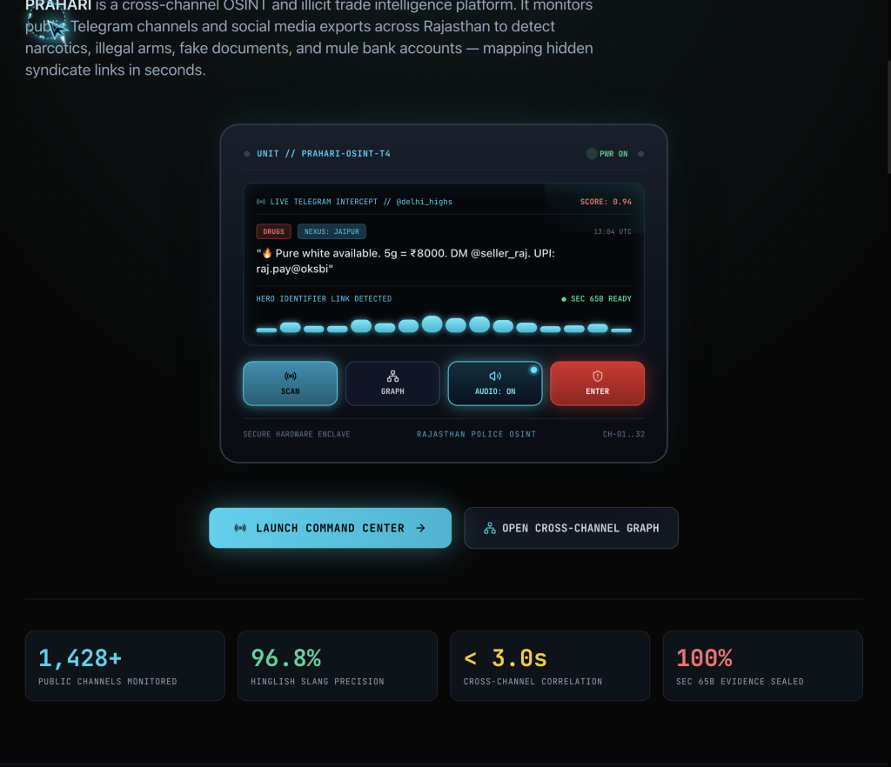
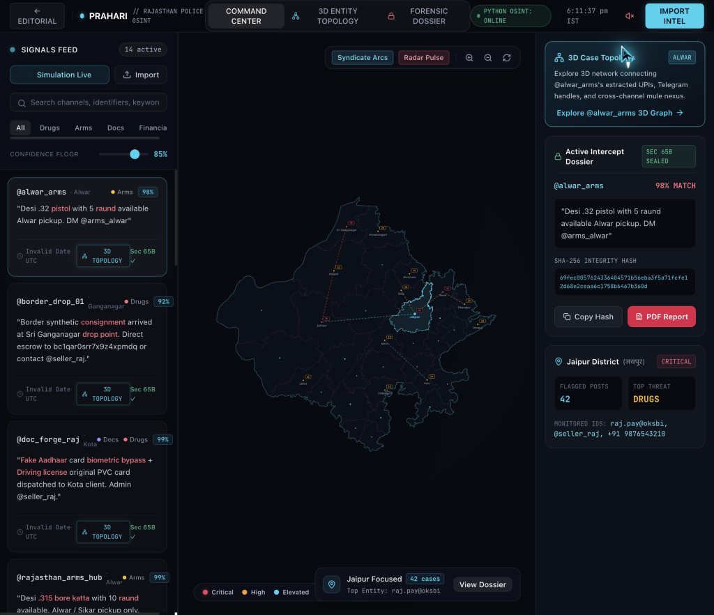
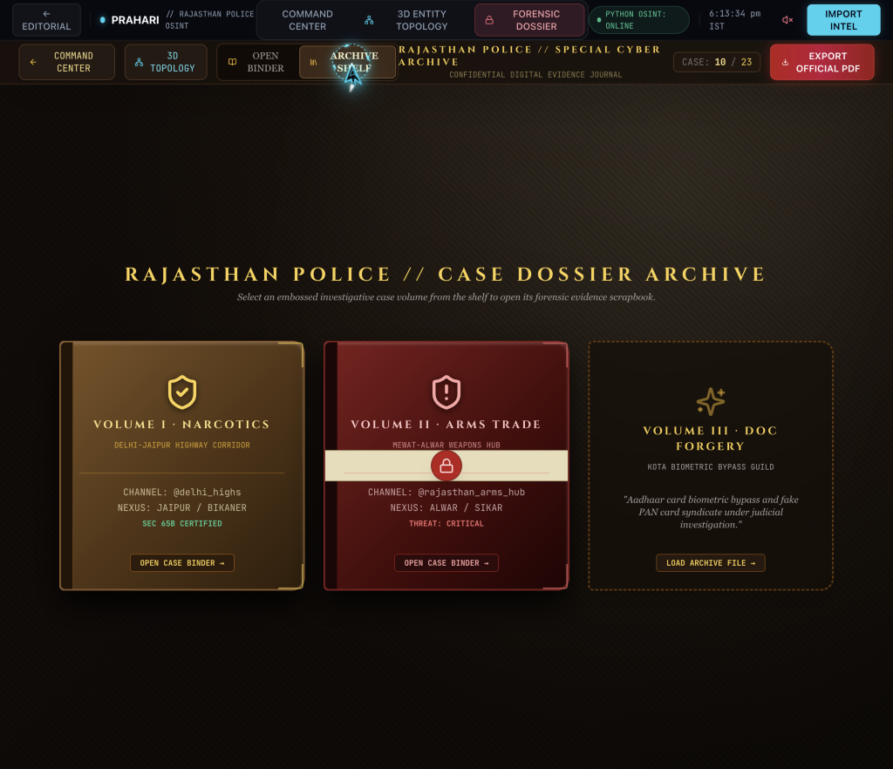
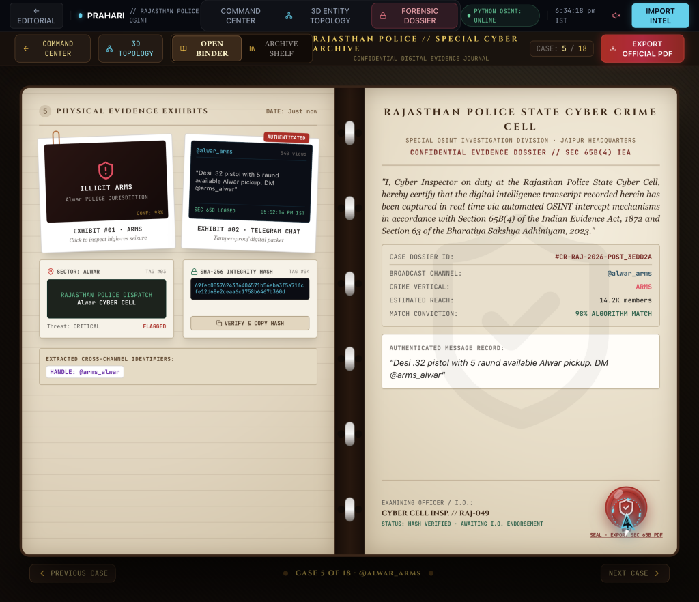
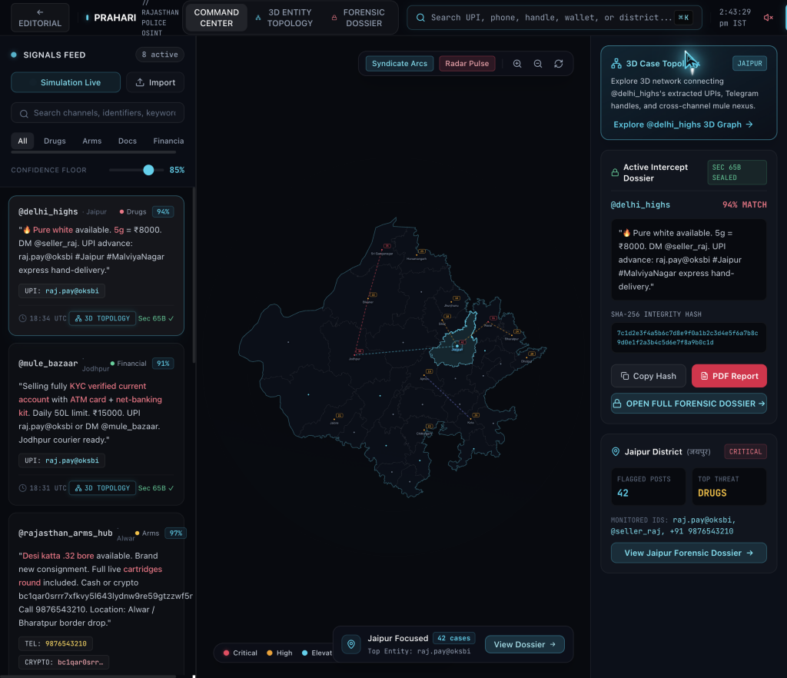

# PRAHARI // प्रहारी — Hackathon Prototype
### Cross-Channel OSINT & Illicit Trade Intelligence Platform
**Concept demonstration for hackathon review | R4C Hackathon 2026**

> **Prototype notice:** The built-in intercepts and background activity are synthetic demonstrations. A Telegram scan includes only content actually returned by a public preview. SHA-256 is calculated over raw text and does not authenticate a source, prove collection time or custody, or certify legal admissibility. Exported reports are demonstrations, not Section 65B / Section 63 certificates. The project is not an operational law-enforcement system.

[](https://react.dev/)
[](https://fastapi.tiangolo.com/)
[](https://developer.mozilla.org/en-US/docs/Web/API/Web_Audio_API)
[](LICENSE)

---

## Executive Overview

> *"The advertisements are public. The networks are not."*

**PRAHARI** (प्रहारी) is a hackathon prototype exploring cross-channel OSINT analysis and illicit trade detection workflows. It is not an operational system for the **Rajasthan Police State Cyber Crime Cell**.

It provides a rules based classifier, entity extraction, graph visualization, CSV/JSON import, and an optional request to a public Telegram preview. It does not autonomously monitor channels or independently verify allegations.

---

## Platform Visual Showcase

### 1. Hardware Tactical Console & Synthesizer
*Hardware-style cyber enclave with real-time signal inspection, live Web Audio API synthesis, and animated waveform visualizer.*


---

### 2. Live Surveillance Command Center & GIS Rajasthan Map
*Geospatial intelligence mesh covering all 33 Rajasthan districts with real-time criminal syndicate arcs, radar sweeps, and live signal telemetry.*


---

### 3. Interactive 3D Case-Specific Entity Topology Graph
*Force-directed 3D network visualizing the nexus between suspect handles, phone numbers, UPI escrow IDs, crypto wallets, and crime categories.*


---

### 4. Skeuomorphic Forensic Dossier (Evidence Scrapbook Binder)
*Investigative case binder laid out across a detective's desk with tilted polaroids, brass paperclips, Section 65B transcript, and interactive 3D Red Wax Seal.*


---

### 5. 3D Embossed Leather Case Archive Shelf
*Toggleable case register shelf view displaying 3D embossed leather volumes (Narcotics, Arms Trade, Document Forgery) that open smoothly into the binder.*


---

### 6. Prototype Report Export
*Demonstration report with the source label and raw text SHA-256 digest. It is not a legal certificate.*


---

### 7. Global Cross-Case OSINT Search (Cmd + K / Ctrl + K)
*Tactical command palette overlay with real-time entity type auto-detection (UPI, phone, handle, crypto wallet, district) and one-click demo pivots.*


---

### 8. Inter-District Demo Record Matches & Geospatial Mesh
*Synthetic example showing how matching records can be grouped by district. Counts are not a risk score or a verified syndicate finding.*


---

## Core Capabilities & Features

### 1. Multi-Dialect NLP & Coded Criminal Slang Detection
- **Four Core Crime Verticals**:
  - **Narcotics**: Detects *afeem*, *charas*, *doda post*, *chitta*, *ice*, *MDMA*, *mephedrone*, and synthetic score keywords.
  - **Illegal Arms**: Identifies country-made *desi katta*, *tamancha*, *.32 bore pistols*, *live cartridges*, and bypass drop points.
  - **Forged Documents**: Flags fake *Aadhaar/PAN* cards, biometric bypasses, forged marksheets, and fake driving licenses.
  - **Mule Accounts**: Detects rented *KYC bank kits*, current accounts with ATM kits, net-banking SIM cards, and USDT crypto arbitrage.
- **Dialect Support**: Hindi, Hinglish, Marwari/Rajasthani regional slang, Romanized terms, and disguised emoji ciphers.

### 2. Rajasthan Tactical GIS Surveillance Map
- **High-Resolution Geo-Mesh**: Interactive SVG vector map of all 33 districts of Rajasthan.
- **Dynamic Threat Coloring**: Categorizes jurisdictions into `CRITICAL`, `HIGH`, `ELEVATED`, and `MODERATE` based on live signal density.
- **Syndicate Arcs**: Visualizes interstate and inter-district trade corridors (e.g., Mewat-Alwar weapons corridor, Sri Ganganagar border drops, Jaipur-Bikaner narcotics transit).
- **One-Click Case Dossier Access**: Clicking any district instantly filters intelligence and allows opening its dedicated forensic dossier.

### 3. 3D Force-Directed Cross-Channel Topology Engine
- **Entity Resolution**: Automatically extracts and links:
  - **UPI IDs**: `raj.pay@oksbi`, `alwar.drop@paytm`, etc.
  - **Phone / WhatsApp**: Standardized Indian telecom numbers (`+91 9876543210`).
  - **Telegram Handles**: Public channel broadcasts and seller usernames.
  - **Cryptocurrency Wallets**: Bitcoin (`bc1q...`), USDT (TRC-20), and Ethereum addresses.
- **Case-Specific Graphs**: Selecting any case dynamically isolates that entity's first-degree and second-degree nexus with radial and orbital node distributions.

### 4. Investigative Scrapbook Forensic Dossier
- **Physical Evidence Collage**: Organizes digital seizures into tangible exhibits with brass paperclips, authenticated Telegram screenshots, and threat tags.
- **Cryptographic Barcode**: Displays full SHA-256 integrity hash with one-click verification and clipboard copy.
- **Interactive 3D Red Wax Seal Stamp**: Clicking the wax seal triggers a mechanical audio effect and generates a clearly labeled prototype report.
- **Archive Volumes Shelf**: 3D embossed leather book interface allowing investigators to browse cases categorized by criminal volume.

### 5. Content Digest
- SHA-256 is computed over the UTF-8 bytes of the displayed raw text.
- The digest can help detect later text changes. It does not authenticate source data, establish chain of custody, or create a legal certificate.
- Precision tabular grid with dynamic height adjustment preventing any text overflow.

### 6. Tactical Web Audio Sound Engine
- 100% synthesized in real time via the browser's native **Web Audio API** (zero external MP3 dependencies).
- Mechanical button clicks, futuristic radar pings, digital lock-on chimes, smooth paper-turning sweeps, and low-frequency wax seal stamps.
- Synchronized between the hero hardware console and the command center header.

### 7. Global Cross-Case OSINT Search & Inter-District Syndicate Matrix (Cmd + K / Ctrl + K)
- **Instant Cross-Referencing**: Persistent search bar trigger and global hotkey `Cmd + K` / `Ctrl + K` allowing investigators to query any token across all Rajasthan districts, Telegram channels, and forensic evidence records in milliseconds.
- **Entity Type Auto-Detection**: Live pill detection for `UPI ID`, `PHONE / WHATSAPP`, `TELEGRAM HANDLE`, `CRYPTO WALLET`, `DISTRICT`, and `KEYWORD`.
- **Inter-District Record Matches**: Summarizes matching records and channels by district. It does not score threat or establish a real-world syndicate.
- **Actionable 1-Click Pivots**: Directly plot the multi-district mesh on the GIS map with glowing animated pulse rings and a floating jurisdiction banner, inspect in 3D topology, or open the Section 65B forensic dossier.

---

## Technical Architecture

```
                                  ┌────────────────────────┐
                                  │   Public OSINT Data    │
                                  │ (Telegram, Web, Feeds) │
                                  └───────────┬────────────┘
                                              │
                                              ▼
┌────────────────────────────────────────────────────────────────────────────────────────┐
│                                 FASTAPI PYTHON BACKEND                                 │
│                                                                                        │
│   ┌────────────────────┐     ┌───────────────────────┐     ┌───────────────────────┐   │
│   │ Telegram Preview  │ ──► │ Rules Based Classifier│ ──► │ SQLite Prototype DB  │   │
│   │  (on request)     │     │  (keyword matching)   │     │   (configurable)     │   │
│   └────────────────────┘     └───────────────────────┘     └───────────┬───────────┘   │
│                                                                        │               │
│                                REST API & Live WebSockets              ▼               │
└─────────────────────────────────────────────┬──────────────────────────────────────────┘
                                              │
                                              ▼
┌────────────────────────────────────────────────────────────────────────────────────────┐
│                                   VITE + REACT 18 SPA                                  │
│                                                                                        │
│   ┌────────────────────┐     ┌───────────────────────┐     ┌───────────────────────┐   │
│   │ Tactical Command   │     │ 3D Entity Topology    │     │  Forensic Dossier     │   │
│   │ Center & GIS Map   │     │ (Force Graph Engine)  │     │  (Scrapbook & Books)  │   │
│   └────────────────────┘     └───────────────────────┘     └───────────┬───────────┘   │
│                                                                        │               │
│                                                                        ▼               │
│                                                            ┌───────────────────────┐   │
│                                                            │ Prototype Report      │   │
│                                                            │ (text digest only)    │   │
│                                                            └───────────────────────┘   │
└────────────────────────────────────────────────────────────────────────────────────────┘
```

---

## Getting Started

### Prerequisites
- **Node.js** >= 18.0.0
- **Python** >= 3.10
- **Git**

### 1. Clone the Repository
```bash
git clone https://github.com/sanskaar-tiwari/prahari-osint.git
cd prahari-osint
```

### 2. Frontend Setup & Launch
```bash
# Install frontend dependencies
npm install

# Start Vite development server
npm run dev
```
Open **`http://localhost:5173`** in your browser.

### 3. Backend Setup & Launch (Optional for Cloud Feed)
```bash
# Navigate to backend directory
cd backend

# Create and activate Python virtual environment
python3 -m venv venv
source venv/bin/activate    # On Windows: venv\Scripts\activate

# Install backend requirements
pip install -r requirements.txt

# Launch FastAPI server with Uvicorn
python -m uvicorn main:app --host 0.0.0.0 --port 8000 --reload
```
The FastAPI documentation will be accessible at **`http://localhost:8000/docs`**.

### Hosted frontend/backend connection

For a hosted frontend, set Vercel's `VITE_API_URL` to the deployed FastAPI HTTPS origin and `VITE_WS_URL` to its secure WebSocket endpoint (`wss://…/ws/stream`). Set the backend's `PRAHARI_CORS_ORIGINS` to the exact deployed frontend origin. The Vite API defaults point to `localhost`, so these variables are required for a hosted frontend to reach a hosted backend. See [backend deployment and SQLite persistence notes](backend/README.md#persistence-and-deployment).

> **Note on Standalone Mode**: When running without the Python backend, PRAHARI automatically operates in autonomous simulation mode using authentic cryptographic digests and mock telemetry so all features (GIS map, 3D topology, and PDF export) remain fully functional for evaluators.

---

## Repository Structure

```
prahari-osint/
├── backend/
│   ├── main.py              # FastAPI server, SQLite DB, WebSockets & REST endpoints
│   ├── requirements.txt     # Python dependencies (fastapi, uvicorn, pydantic)
│   └── prahari.db           # Persistent SQLite database for evidence and hashes
├── docs/
│   └── screenshots/         # High-resolution platform screenshots
├── src/
│   ├── components/
│   │   ├── CommandCenter.tsx        # Tactical surveillance dashboard
│   │   ├── EditorialShowcase.tsx    # High-impact landing page & hardware console
│   │   ├── EntityTopologyPage.tsx   # Interactive 3D force-directed network graph
│   │   ├── ForensicDossier.tsx      # Scrapbook binder with polaroids & wax seal
│   │   ├── GlobalOsintSearchModal.tsx # Cross-case OSINT search & syndicate matrix (Cmd+K)
│   │   ├── LiveInterceptFeed.tsx    # Real-time Telegram signal intercept feed
│   │   ├── RajasthanMap.tsx         # Interactive 33-district GIS surveillance map
│   │   ├── TacticalCursor.tsx       # Custom illuminated cyber thruster cursor
│   │   └── WarMonitorLiveApp.tsx    # Core multi-view application shell
│   ├── data/
│   │   └── mockData.ts              # Rajasthan telemetry, channels, and slang lexicons
│   ├── utils/
│   │   ├── audio.ts                 # Web Audio API real-time sound synthesizer
│   │   └── pdfGenerator.ts          # Prototype report export
│   ├── App.tsx                      # Root application component with transitions
│   └── main.tsx                     # React application entry point
├── package.json                     # Frontend dependencies & npm scripts
├── tailwind.config.js               # Tactical dark palette and typography config
├── vite.config.ts                   # Vite bundler configuration
└── README.md                        # Documentation & setup guide
```

---

## Evidence and data limitations

PRAHARI's SHA-256 value is computed over raw text only. SQLite is mutable, the graph is reconstructed in memory from recent rows, and the app does not provide a verified acquisition process or chain-of-custody log. Reports do not certify compliance with Section 65B or Section 63. Built-in records, district telemetry, and the animated feed are synthetic demonstrations.

---

## R4C Hackathon 2026 Evaluation Rubric Alignment

| Dimension | Manual Cyber Cell Analyst | PRAHARI Platform |
| :--- | :--- | :--- |
| **Monitoring Volume** | Manual review | One public preview request at a time; not continuous monitoring |
| **Slang Detection** | Subjective, misses local dialects & emojis | Automated multi-dialect weighted NLP scoring |
| **Entity Correlation** | Manual Excel lookup (Hours to Days) | Instant 3D graph topology resolution (< 3s) |
| **Geospatial Mapping** | Static pins or disconnected spreadsheets | Interactive 33-district GIS mesh with criminal arcs |
| **Evidence integrity** | Manual handling | Raw text digest shown in a prototype report; no legal certification |

---

## Authors & Acknowledgments

- **Lead Developer**: Sanskaar Tiwari
  - LinkedIn: [sanskaar-tiwari](https://www.linkedin.com/in/sanskaar-tiwari/)
  - Email: [sanskaar0tiwari@gmail.com](mailto:sanskaar0tiwari@gmail.com)
  - GitHub: [@sanskaar-tiwari](https://github.com/sanskaar-tiwari)
- **Context**: R4C Hackathon 2026 concept demonstration; no official agency endorsement is implied.
- Dedicated to modernizing cyber defense, dark web surveillance, and illicit trade prevention for law enforcement agencies across India.

---
*License: [MIT](LICENSE) · Hackathon concept prototype*
