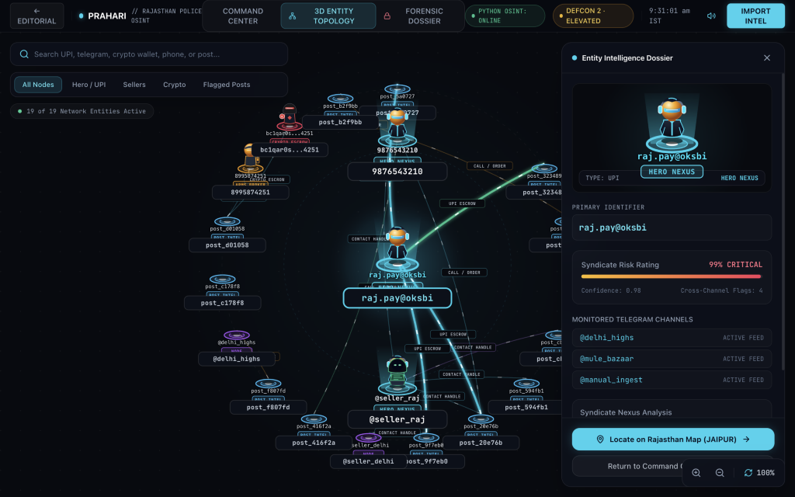
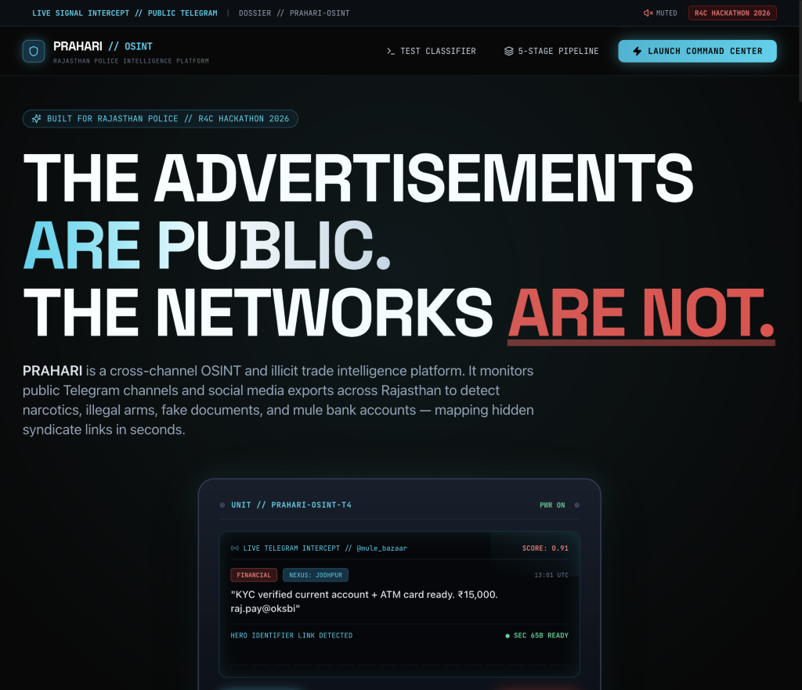

# PRAHARI // प्रहारी — Hackathon Prototype
### Cross-Channel OSINT & Illicit Trade Intelligence Platform
**Concept demonstration for hackathon review | R4C Hackathon 2026**

### 🔗 Live demo: **[hacka-xi.vercel.app](https://hacka-xi.vercel.app/)**

> **Prototype notice:** The built-in intercepts and background activity are synthetic demonstrations. A Telegram scan includes only content actually returned by a public preview. SHA-256 is calculated over raw text and does not authenticate a source, prove collection time or custody, or certify legal admissibility. Exported reports are demonstrations, not Section 65B / Section 63 certificates. The project is not an operational law-enforcement system.

[](https://react.dev/)
[](https://fastapi.tiangolo.com/)
[](https://developer.mozilla.org/en-US/docs/Web/API/Web_Audio_API)
[](LICENSE)
[](https://hacka-xi.vercel.app/)

---

## Executive Overview

> *"The advertisements are public. The networks are not."*

**PRAHARI** (प्रहारी) is a hackathon prototype exploring cross-channel OSINT analysis and illicit trade detection workflows. It is not an operational system for the **Rajasthan Police State Cyber Crime Cell**.

It provides a rules based classifier, entity extraction, graph visualization, CSV/JSON import, and an optional request to a public Telegram preview. It does not autonomously monitor channels or independently verify allegations.

---

## Platform Visual Showcase

### 1. Hardware Tactical Console & Synthesizer
*Hardware-style cyber enclave with real-time signal inspection, live Web Audio API synthesis, and animated waveform visualizer.*


---

### 2. Live Surveillance Command Center & GIS Rajasthan Map
*Geospatial intelligence mesh covering all 41 Rajasthan districts with real-time criminal syndicate arcs, radar sweeps, and live signal telemetry.*


---

### 3. Interactive 3D Case-Specific Entity Topology Graph
*Force-directed 3D network visualizing the nexus between suspect handles, phone numbers, UPI escrow IDs, crypto wallets, and crime categories.*


---

### 4. Skeuomorphic Forensic Dossier (Evidence Scrapbook Binder)
*Investigative case binder laid out across a detective's desk with tilted polaroids, brass paperclips, raw-text transcript, and interactive 3D Red Wax Seal.*


---

### 5. 3D Embossed Leather Case Archive Shelf
*Toggleable case register shelf view displaying 3D embossed leather volumes (Narcotics, Arms Trade, Document Forgery) that open smoothly into the binder.*


---

### 6. Prototype Report Export
*Demonstration report with the source label and raw text SHA-256 digest. It is not a legal certificate.*


---

### 7. Global Cross-Case OSINT Search (Cmd + K / Ctrl + K)
*Tactical command palette overlay with real-time entity type auto-detection (UPI, phone, handle, crypto wallet, district) and one-click demo pivots.*


---

### 8. Inter-District Demo Record Matches & Geospatial Mesh
*Synthetic example showing how matching records can be grouped by district. Counts are not a risk score or a verified syndicate finding.*


---

## Core Capabilities & Features

### 1. Multi-Dialect NLP & Coded Criminal Slang Detection
- **Four Core Crime Verticals**:
  - **Narcotics**: Detects *afeem*, *charas*, *doda post*, *chitta*, *ice*, *MDMA*, *mephedrone*, and synthetic score keywords.
  - **Illegal Arms**: Identifies country-made *desi katta*, *tamancha*, *.32 bore pistols*, *live cartridges*, and bypass drop points.
  - **Forged Documents**: Flags fake *Aadhaar/PAN* cards, biometric bypasses, forged marksheets, and fake driving licenses.
  - **Mule Accounts**: Detects rented *KYC bank kits*, current accounts with ATM kits, net-banking SIM cards, and USDT crypto arbitrage.
- **Dialect Support**: Hindi, Hinglish, Marwari/Rajasthani regional slang, Romanized terms, and disguised emoji ciphers.
- **Context rules, not just keywords**: a single keyword is not enough ("Chitta village fair on Sunday" is not flagged); it needs a sale context (offer, price, contact, quantity) or a second matched term. News, warnings and shop notices ("Police seized 5 kg of ganja", "Beware of fake Aadhaar scams") need an explicit offer to sell. One emoji alone never flags.
- **Evasion handling**: spaced or spelled-out digits (`9 0 0 0...`, `nine zero...`, `nau shunya...`), Devanagari and full-width digits, zero-width characters, look-alike Cyrillic/Greek letters, leetspeak (`ch1tta`), spaced letters, and UPI IDs written as `name (at) upi` or `name dot user at upi`. The stored text and its SHA-256 are never changed; identifiers are extracted from a normalised copy.
- **SIM-card trade** (pre-activated / no-KYC / bulk SIMs) is detected under the financial category. Each flagged post also gets a **direction** (selling, buying, rent offered, rent wanted) and a **platform** field.
- **Shared identifiers are not links**: generic handles (`@admin`, `@support`), placeholder numbers (`9999999999`) and toll-free numbers are reported separately and never create graph links or cross-channel risk. UPI IDs, handles and `0x` wallets are lower-cased before linking, so `Raj.Pay@OKSBI` and `raj.pay@oksbi` are one node.

### 2. Rajasthan Tactical GIS Surveillance Map
- **High-Resolution Geo-Mesh**: Interactive MapLibre map of all 41 districts of Rajasthan (bundled boundaries; falls back to a plain dark basemap if map tiles cannot load).
- **Dynamic Threat Coloring**: Categorizes jurisdictions into `CRITICAL`, `HIGH`, `ELEVATED`, and `MODERATE` based on live signal density.
- **Syndicate Arcs**: Visualizes interstate and inter-district trade corridors (e.g., Mewat-Alwar weapons corridor, Sri Ganganagar border drops, Jaipur-Bikaner narcotics transit).
- **One-Click Case Dossier Access**: Clicking any district instantly filters intelligence and allows opening its dedicated forensic dossier.

### 3. 3D Force-Directed Cross-Channel Topology Engine
- **Entity Resolution**: Automatically extracts and links:
  - **UPI IDs**: `raj.pay@oksbi`, `alwar.drop@paytm`, etc.
  - **Phone / WhatsApp**: Standardized Indian telecom numbers (`+91 9876543210`).
  - **Telegram Handles**: Public channel broadcasts and seller usernames.
  - **Cryptocurrency Wallets**: Bitcoin (`bc1q...`), USDT (TRC-20), and Ethereum addresses.
- **Case-Specific Graphs**: Selecting any case dynamically isolates that entity's first-degree and second-degree nexus with radial and orbital node distributions.

### 4. Investigative Scrapbook Forensic Dossier
- **Physical Evidence Collage**: Organizes digital seizures into tangible exhibits with brass paperclips, sample Telegram-style screenshots, and threat tags.
- **Cryptographic Barcode**: Displays full SHA-256 integrity hash with one-click verification and clipboard copy.
- **Interactive 3D Red Wax Seal Stamp**: Clicking the wax seal triggers a mechanical audio effect and generates a clearly labeled prototype report.
- **Archive Volumes Shelf**: 3D embossed leather book interface allowing investigators to browse cases categorized by criminal volume.

### 5. Content Digest
- SHA-256 is computed over the UTF-8 bytes of the displayed raw text.
- The digest can help detect later text changes. It does not authenticate source data, establish chain of custody, or create a legal certificate.
- Precision tabular grid with dynamic height adjustment preventing any text overflow.

### 5b. Analyst workflow, audit log and export
- **Re-verify hash**: the dossier can ask the server to re-hash the text it has stored now and compare it with the digest recorded at capture (detects a changed record; says nothing about who captured it).
- **Status workflow**: `NEW -> REVIEWING -> ESCALATED / FALSE POSITIVE / CLOSED`, with a note. Status lives in its own table, so working a case never changes the evidence record.
- **Audit trail**: every ingest, status change, hash re-verification and export is logged in a hash-chained table (each entry stores the hash of the previous one, so editing or deleting an old row is detected by `GET /api/audit/verify`). There are no user accounts: the analyst name is typed in, so the log shows who *said* they acted.
- **Export**: alerts as CSV or JSON (`GET /api/export`), with spreadsheet-formula neutralisation for untrusted text.
- **Re-import safe**: the same message (same channel, same exact text, same source timestamp) is never stored twice; the import reports how many were skipped.
- **Screenshots / images**: OCR runs in the browser (self-hosted tesseract.js, no CDN) or on the server when `tesseract` is installed; the image gets a SHA-256 and a perceptual hash, so the same picture re-posted in another channel (even resized or re-compressed) is linked in the graph and adds to the risk score. The image file itself is not stored.

### 5c. PS02 demo dataset and complaint cross-check
- **Import the whole dataset**: Import Intel > CSV / JSON > *Choose dataset folder* takes the `PS02_demo_data` folder: all 13 Telegram Desktop exports (`result.json`) and `posts.csv` (1,787 text posts, about 7 s locally). Author, forwarded-from (shown as a `FORWARDED FROM` graph edge), IST time, location tag and image name are kept. Picture-only posts (63, no caption) are read with OCR in the browser during the same import (each unique picture once; tick box on by default), stored under their channel with the post's own time, and classified like text posts.
- **Our evaluation on it** (`python backend/eval/eval_ps02.py /path/to/PS02_demo_data`): we labelled the 215 unique texts ourselves (`backend/eval/ps02_labels.json`, keyed by SHA-256, no post text; *not* the official answer key). Before tuning: precision 86.6%, recall 33.4%. After: 100% / 100% on 1,709 posts, 0 false flags on the 842 normal posts. Split by template family, the held-out half scored 100% before any of its errors were looked at. The dataset is template-generated, so this says the rules cover these patterns; it does not predict real-world accuracy.
- **Posters**: three OCR passes (as uploaded, grey upscaled copy, 5x5 median-denoised copy), English + Hindi, then border noise (`|`, `!`, `«`, lone matras) is dropped before classifying. On the 18 posters: 14/18 categories right and 17/19 expected identifiers found, same in the browser (tesseract.js) and on the server (one English pass: 11/18, 14/19). Misses: two posters whose only drug signal is emoji (OCR cannot read emoji), a heavily stylised one, and a USDT wallet that comes out garbled.
- **Complaint cross-check (Suspect Repository)**: Import Intel > Complaints (NCRP) uploads the complaint CSVs at run time. Only the acknowledgement number, district, police station, category, date and suspect identifiers are stored; complaint text and names are discarded, masked emails ignored. A post whose UPI / phone / handle / bank account / wallet matches a complaint gets +2 risk, an `IN N COMPLAINTS` badge and the ack numbers. These files are real data: they are in `.gitignore`, never committed or bundled. Set `PRAHARI_ADMIN_TOKEN` on the server to require a token for upload/clear.

### 6. Tactical Web Audio Sound Engine
- 100% synthesized in real time via the browser's native **Web Audio API** (zero external MP3 dependencies).
- Mechanical button clicks, futuristic radar pings, digital lock-on chimes, smooth paper-turning sweeps, and low-frequency wax seal stamps.
- Synchronized between the hero hardware console and the command center header.

### 7. Global Cross-Case OSINT Search & Inter-District Syndicate Matrix (Cmd + K / Ctrl + K)
- **Instant Cross-Referencing**: Persistent search bar trigger and global hotkey `Cmd + K` / `Ctrl + K` allowing investigators to query any token across all Rajasthan districts, Telegram channels, and forensic evidence records in milliseconds.
- **Entity Type Auto-Detection**: Live pill detection for `UPI ID`, `PHONE / WHATSAPP`, `TELEGRAM HANDLE`, `CRYPTO WALLET`, `DISTRICT`, and `KEYWORD`.
- **Inter-District Record Matches**: Summarizes matching records and channels by district. It does not score threat or establish a real-world syndicate.
- **Actionable 1-Click Pivots**: Directly plot the multi-district mesh on the GIS map with glowing animated pulse rings and a floating jurisdiction banner, inspect in 3D topology, or open the forensic dossier.

---

## Technical Architecture

```
                                  ┌────────────────────────┐
                                  │   Public OSINT Data    │
                                  │ (Telegram, Web, Feeds) │
                                  └───────────┬────────────┘
                                              │
                                              ▼
┌────────────────────────────────────────────────────────────────────────────────────────┐
│                                 FASTAPI PYTHON BACKEND                                 │
│                                                                                        │
│   ┌────────────────────┐     ┌───────────────────────┐     ┌───────────────────────┐   │
│   │ Telegram Preview  │ ──► │ Rules Based Classifier│ ──► │ SQLite Prototype DB  │   │
│   │  (on request)     │     │  (keyword matching)   │     │   (configurable)     │   │
│   └────────────────────┘     └───────────────────────┘     └───────────┬───────────┘   │
│                                                                        │               │
│                                REST API & Live WebSockets              ▼               │
└─────────────────────────────────────────────┬──────────────────────────────────────────┘
                                              │
                                              ▼
┌────────────────────────────────────────────────────────────────────────────────────────┐
│                                   VITE + REACT 18 SPA                                  │
│                                                                                        │
│   ┌────────────────────┐     ┌───────────────────────┐     ┌───────────────────────┐   │
│   │ Tactical Command   │     │ 3D Entity Topology    │     │  Forensic Dossier     │   │
│   │ Center & GIS Map   │     │ (Force Graph Engine)  │     │  (Scrapbook & Books)  │   │
│   └────────────────────┘     └───────────────────────┘     └───────────┬───────────┘   │
│                                                                        │               │
│                                                                        ▼               │
│                                                            ┌───────────────────────┐   │
│                                                            │ Prototype Report      │   │
│                                                            │ (text digest only)    │   │
│                                                            └───────────────────────┘   │
└────────────────────────────────────────────────────────────────────────────────────────┘
```

---

## Getting Started

### Prerequisites
- **Node.js** >= 18.0.0
- **Python** >= 3.10
- **Git**

### 1. Clone the Repository
```bash
git clone https://github.com/sanskaar-tiwari/prahari-osint.git
cd prahari-osint
```

### 2. Frontend Setup & Launch
```bash
# Install frontend dependencies
npm install

# Start Vite development server
npm run dev
```
Open **`http://localhost:5173`** in your browser.

### 3. Backend Setup & Launch (Optional for Cloud Feed)
```bash
# Navigate to backend directory
cd backend

# Create and activate Python virtual environment
python3 -m venv venv
source venv/bin/activate    # On Windows: venv\Scripts\activate

# Install backend requirements
pip install -r requirements.txt

# Required: a random access token for the API (the server refuses to start without one)
# Recommended: a fixed secret for signing officer logins (otherwise logins reset on every restart)
export PRAHARI_JWT_SECRET=$(python -c 'import secrets; print(secrets.token_urlsafe(48))')

# Launch FastAPI server with Uvicorn
python -m uvicorn main:app --host 0.0.0.0 --port 8000 --reload
```
The FastAPI documentation will be accessible at **`http://localhost:8000/docs`** (use the **Authorize** button with the token).

**Demo officers** (seeded into an empty database for evaluation; set `PRAHARI_SEED_DEMO_OFFICERS=0` to disable). Password for all three: `Prahari@2026`.

| Username | Officer | Rank | Can escalate / close |
|---|---|---|---|
| `inspector_alwar` | Vikram Singh Rathore, RJ-CY-4412, Alwar | INSPECTOR | yes |
| `dsp_jaipur` | Ananya Sharma, RJ-IPS-1092, Jaipur Rural | DSP | yes |
| `constable_ganganagar` | Manish Meena, RJ-CY-7821, Sri Ganganagar | CONSTABLE | no (triage only) |

On first start the backend creates its Ed25519 signing key at `backend/keys/station_ed25519.key` (permissions `0600`, git-ignored) and prints a warning to back it up.

### Hosted frontend/backend connection

For a hosted frontend, set Vercel's `VITE_API_URL` to the deployed FastAPI HTTPS origin and `VITE_WS_URL` to its secure WebSocket endpoint (`wss://…/ws/stream`). Set the backend's `PRAHARI_CORS_ORIGINS` to the exact deployed frontend origin (`*` is refused; Vercel preview URLs need an explicit `PRAHARI_CORS_REGEX` that matches only your project). Set `PRAHARI_JWT_SECRET` on the backend. Officers sign in with their own username and password; the session token is stored in their browser and never built into the frontend. The Vite API defaults point to `localhost`, so these variables are required for a hosted frontend to reach a hosted backend. See [backend deployment and SQLite persistence notes](backend/README.md#persistence-and-deployment).

> **Note on Standalone Mode**: When running without the Python backend, PRAHARI automatically operates in autonomous simulation mode using authentic cryptographic digests and mock telemetry so all features (GIS map, 3D topology, and PDF export) remain fully functional for evaluators.

---

## Repository Structure

```
prahari-osint/
├── backend/
│   ├── main.py              # FastAPI server, SQLite DB, WebSockets & REST endpoints
│   ├── auth.py              # Bearer-token check for /api/* and the WebSocket
│   ├── sign.py              # Ed25519 station key (PyNaCl): load/create, sign, verify
│   ├── evidence.py          # Append-only records + signed hash chain, chain verification
│   ├── requirements.txt     # Python dependencies (fastapi, uvicorn, pydantic, pynacl)
│   └── prahari.db           # Persistent SQLite database for evidence and hashes
├── docs/
│   └── screenshots/         # High-resolution platform screenshots
├── src/
│   ├── components/
│   │   ├── CommandCenter.tsx        # Tactical surveillance dashboard
│   │   ├── EditorialShowcase.tsx    # High-impact landing page & hardware console
│   │   ├── EntityTopologyPage.tsx   # Interactive 3D force-directed network graph
│   │   ├── ForensicDossier.tsx      # Scrapbook binder with polaroids & wax seal
│   │   ├── GlobalOsintSearchModal.tsx # Cross-case OSINT search & syndicate matrix (Cmd+K)
│   │   ├── LiveInterceptFeed.tsx    # Real-time Telegram signal intercept feed
│   │   ├── RajasthanMap.tsx         # Interactive 41-district GIS surveillance map (MapLibre)
│   │   ├── TacticalCursor.tsx       # Custom illuminated cyber thruster cursor
│   │   └── WarMonitorLiveApp.tsx    # Core multi-view application shell
│   ├── data/
│   │   └── mockData.ts              # Rajasthan telemetry, channels, and slang lexicons
│   ├── utils/
│   │   ├── audio.ts                 # Web Audio API real-time sound synthesizer
│   │   └── pdfGenerator.ts          # Prototype report export
│   ├── App.tsx                      # Root application component with transitions
│   └── main.tsx                     # React application entry point
├── package.json                     # Frontend dependencies & npm scripts
├── tailwind.config.js               # Tactical dark palette and typography config
├── vite.config.ts                   # Vite bundler configuration
└── README.md                        # Documentation & setup guide
```

---

## Legal & evidentiary framework

Electronic records in Indian courts are governed by **Section 63 of the Bharatiya Sakshya Adhiniyam, 2023 (BSA)**, in force since 1 July 2024, which replaced Section 65B of the Indian Evidence Act, 1872 (65B still applies to older proceedings). Admissibility depends on the certificate in the BSA Schedule, signed by the person in charge of the device and, where required, an expert. **PRAHARI is not "compliant" with Section 63 and does not issue that certificate.** It produces data that can support preparing one: a per-record SHA-256 hash and a signed, verifiable integrity trail. Have the police legal cell confirm any evidentiary use.

| Control | Status | Details |
|---|---|---|
| SHA-256 content hash | Implemented | Over the UTF-8 bytes of `rawText`, recorded at capture; re-checked by `POST /api/dossier/{id}/verify` |
| Ed25519 station signature | Implemented | Real signature (PyNaCl / libsodium) over each chain link's canonical JSON; public key at `GET /api/pubkey` |
| Append-only evidence chain | Implemented | `evidence_chain` table in SQLite: `chain_hash = sha256(sequence\|prevHash\|recordSha256\|createdAt)`, written in the same transaction as the record; `GET /api/chain/verify`, `GET /api/chain/head` |
| Append-only records | Implemented | SQLite triggers reject UPDATE/DELETE on records, chain links and keys |
| Hash-chained audit log | Implemented | Status changes, verifications, exports; `GET /api/audit/verify` |
| Officer authentication & RBAC | Implemented | Per-officer accounts (scrypt-hashed passwords, 24 h HS256 session tokens). Ranks CONSTABLE < INSPECTOR < DSP < ADMIN; ESCALATED/CLOSED and NCRP complaint upload/delete need INSPECTOR+. Audit entries name the signed-in officer, never a client-typed name, and the officer's badge is inside each entry's hash |
| RFC 3161 trusted timestamp | **Not implemented** | Needs an external Time Stamping Authority. `createdAt` is the server clock and is not independently attested; records say `"notImplemented": true` |
| External WORM / write-once storage | **Not implemented** | Records live in an ordinary SQLite file |
| Hardware key storage (HSM) | **Not implemented** | The private key is a file (or env var) on the server |
| Per-officer identity in signatures | **Not implemented** | The signature identifies the server, not the person who collected the content |

**Known limitation:** someone with full control of the server holds both the database and the private key, and could rebuild and re-sign the entire chain. Record the output of `GET /api/chain/head` and `GET /api/pubkey` somewhere off the server (printout, e-mail, case file) at least daily so a rebuilt chain would be noticed. Records captured before this chain was added are reported as `unchainedRecords` and are not covered.

## Evidence and data limitations

PRAHARI's SHA-256 value is computed over raw text only. The graph is reconstructed in memory from recent rows, and the app does not provide a verified acquisition process. The record store, evidence chain and audit log are tamper-evident (edits are detectable), but they are not a chain of custody, and someone who controls the server could rewrite them (see the limitation above). Image matching uses a 64-bit perceptual hash (distance 10 or less), which finds re-encoded or resized copies of the same picture, not similar-looking different pictures. The free hosting tier has no `tesseract` binary, so server-side OCR is off there; OCR in the browser still works (set `PRAHARI_SERVER_OCR=0` to test that path locally). Reports do not certify compliance with Section 65B or Section 63. Built-in records, district telemetry, and the animated feed are synthetic demonstrations.

---

## R4C Hackathon 2026 Evaluation Rubric Alignment

| Dimension | Manual Cyber Cell Analyst | PRAHARI Platform |
| :--- | :--- | :--- |
| **Monitoring Volume** | Manual review | One public preview request at a time; not continuous monitoring |
| **Slang Detection** | Subjective, misses local dialects & emojis | Automated multi-dialect weighted NLP scoring |
| **Entity Correlation** | Manual Excel lookup (Hours to Days) | Instant 3D graph topology resolution (< 3s) |
| **Geospatial Mapping** | Static pins or disconnected spreadsheets | Interactive 41-district GIS mesh with criminal arcs |
| **Evidence integrity** | Manual handling | Raw text digest shown in a prototype report; no legal certification |

---

## Authors & Acknowledgments

- **Lead Developer**: Sanskaar Tiwari
  - LinkedIn: [sanskaar-tiwari](https://www.linkedin.com/in/sanskaar-tiwari/)
  - Email: [sanskaar0tiwari@gmail.com](mailto:sanskaar0tiwari@gmail.com)
  - GitHub: [@sanskaar-tiwari](https://github.com/sanskaar-tiwari)
- **Context**: R4C Hackathon 2026 concept demonstration; no official agency endorsement is implied.
- Dedicated to modernizing cyber defense, dark web surveillance, and illicit trade prevention for law enforcement agencies across India.

---
*License: [MIT](LICENSE) · Hackathon concept prototype*
