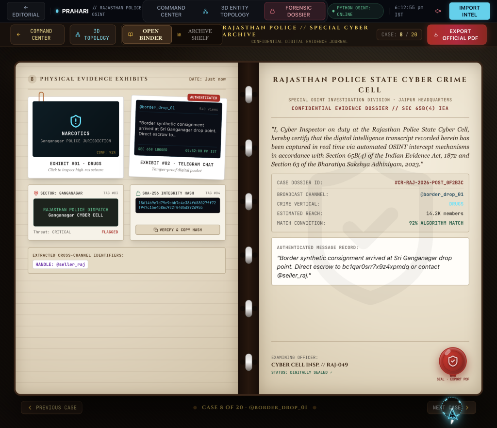

# PRAHARI // प्रहारी
### Cross-Channel OSINT & Illicit Trade Intelligence Platform
**Built for Rajasthan Police State Cyber Crime Cell | R4C Hackathon 2026**

[](https://react.dev/)
[](https://fastapi.tiangolo.com/)
[_IEA_%2B_Sec_63_BSA-F43F5E?style=for-the-badge)](https://indiankanoon.org/doc/1712542/)
[](https://developer.mozilla.org/en-US/docs/Web/API/Web_Audio_API)
[](LICENSE)

---

## Executive Overview

> *"The advertisements are public. The networks are not."*

**PRAHARI** (प्रहारी) is an advanced, cross-channel Open Source Intelligence (OSINT) and illicit trade detection platform engineered specifically for the **Rajasthan Police State Cyber Crime Cell**. 

It autonomously monitors public Telegram channels, social media broadcasts, and forum exports across Rajasthan to detect **narcotics trafficking**, **illegal arms trade**, **forged government documents (Aadhaar/PAN)**, and **mule bank accounts** — correlating disparate digital footprints into an actionable 3D criminal syndicate topology within seconds.

---

## Platform Visual Showcase

### 1. Hardware Tactical Console & Synthesizer
*Hardware-style cyber enclave with real-time signal inspection, live Web Audio API synthesis, and animated waveform visualizer.*


---

### 2. Live Surveillance Command Center & GIS Rajasthan Map
*Geospatial intelligence mesh covering all 33 Rajasthan districts with real-time criminal syndicate arcs, radar sweeps, and live signal telemetry.*


---

### 3. Interactive 3D Case-Specific Entity Topology Graph
*Force-directed 3D network visualizing the nexus between suspect handles, phone numbers, UPI escrow IDs, crypto wallets, and crime categories.*


---

### 4. Skeuomorphic Forensic Dossier (Evidence Scrapbook Binder)
*Investigative case binder laid out across a detective's desk with tilted polaroids, brass paperclips, Section 65B transcript, and interactive 3D Red Wax Seal.*


---

### 5. 3D Embossed Leather Case Archive Shelf
*Toggleable case register shelf view displaying 3D embossed leather volumes (Narcotics, Arms Trade, Document Forgery) that open smoothly into the binder.*


---

### 6. Court-Admissible Section 65B Evidence PDF Export
*Two-tier statutory evidence dossier with FIPS-180-4 SHA-256 payload integrity, dual system witness, and Investigating Officer (I.O.) endorsement block.*


---

### 7. Global Cross-Case OSINT Search (Cmd + K / Ctrl + K)
*Tactical command palette overlay with real-time entity type auto-detection (UPI, phone, handle, crypto wallet, district) and one-click demo pivots.*


---

### 8. Inter-District Syndicate Matrix & Geospatial Mesh
*Cross-jurisdictional intelligence card showing multi-district footprint pills (Jaipur, Jodhpur, Sri Ganganagar), 99% critical syndicate risk score, and one-click GIS plotting with top-banner alert.*


---

## Core Capabilities & Features

### 1. Multi-Dialect NLP & Coded Criminal Slang Detection
- **Four Core Crime Verticals**:
  - **Narcotics**: Detects *afeem*, *charas*, *doda post*, *chitta*, *ice*, *MDMA*, *mephedrone*, and synthetic score keywords.
  - **Illegal Arms**: Identifies country-made *desi katta*, *tamancha*, *.32 bore pistols*, *live cartridges*, and bypass drop points.
  - **Forged Documents**: Flags fake *Aadhaar/PAN* cards, biometric bypasses, forged marksheets, and fake driving licenses.
  - **Mule Accounts**: Detects rented *KYC bank kits*, current accounts with ATM kits, net-banking SIM cards, and USDT crypto arbitrage.
- **Dialect Support**: Hindi, Hinglish, Marwari/Rajasthani regional slang, Romanized terms, and disguised emoji ciphers.

### 2. Rajasthan Tactical GIS Surveillance Map
- **High-Resolution Geo-Mesh**: Interactive SVG vector map of all 33 districts of Rajasthan.
- **Dynamic Threat Coloring**: Categorizes jurisdictions into `CRITICAL`, `HIGH`, `ELEVATED`, and `MODERATE` based on live signal density.
- **Syndicate Arcs**: Visualizes interstate and inter-district trade corridors (e.g., Mewat-Alwar weapons corridor, Sri Ganganagar border drops, Jaipur-Bikaner narcotics transit).
- **One-Click Case Dossier Access**: Clicking any district instantly filters intelligence and allows opening its dedicated forensic dossier.

### 3. 3D Force-Directed Cross-Channel Topology Engine
- **Entity Resolution**: Automatically extracts and links:
  - **UPI IDs**: `raj.pay@oksbi`, `alwar.drop@paytm`, etc.
  - **Phone / WhatsApp**: Standardized Indian telecom numbers (`+91 9876543210`).
  - **Telegram Handles**: Public channel broadcasts and seller usernames.
  - **Cryptocurrency Wallets**: Bitcoin (`bc1q...`), USDT (TRC-20), and Ethereum addresses.
- **Case-Specific Graphs**: Selecting any case dynamically isolates that entity's first-degree and second-degree nexus with radial and orbital node distributions.

### 4. Investigative Scrapbook Forensic Dossier
- **Physical Evidence Collage**: Organizes digital seizures into tangible exhibits with brass paperclips, authenticated Telegram screenshots, and threat tags.
- **Cryptographic Barcode**: Displays full SHA-256 integrity hash with one-click verification and clipboard copy.
- **Interactive 3D Red Wax Seal Stamp**: Clicking the wax seal triggers an authentic mechanical stamping audio effect and generates the court-admissible PDF report.
- **Archive Volumes Shelf**: 3D embossed leather book interface allowing investigators to browse cases categorized by criminal volume.

### 5. Court-Admissible Section 65B Evidence Compliance
- Compliant with **Section 65B(4) of the Indian Evidence Act, 1872** and **Section 63 of the Bharatiya Sakshya Adhiniyam, 2023**.
- Adheres to Supreme Court precedent in ***Arjun Panditrao Khotkar v. Kailash Kushanrao Gorantyal (2020) 7 SCC 1***:
  - **Tier 1 (Automated Machine Witness)**: Platform version, UTC/IST timestamp, and FIPS-180-4 SHA-256 payload integrity digest.
  - **Tier 2 (Human Legal Endorsement)**: Designated Investigating Officer (I.O.) endorsement block with Name, Rank, PPO Number, Police Station, and official seal/stamp area.
- Precision tabular grid with dynamic height adjustment preventing any text overflow.

### 6. Tactical Web Audio Sound Engine
- 100% synthesized in real time via the browser's native **Web Audio API** (zero external MP3 dependencies).
- Mechanical button clicks, futuristic radar pings, digital lock-on chimes, smooth paper-turning sweeps, and low-frequency wax seal stamps.
- Synchronized between the hero hardware console and the command center header.

### 7. Global Cross-Case OSINT Search & Inter-District Syndicate Matrix (Cmd + K / Ctrl + K)
- **Instant Cross-Referencing**: Persistent search bar trigger and global hotkey `Cmd + K` / `Ctrl + K` allowing investigators to query any token across all Rajasthan districts, Telegram channels, and forensic evidence records in milliseconds.
- **Entity Type Auto-Detection**: Live pill detection for `UPI ID`, `PHONE / WHATSAPP`, `TELEGRAM HANDLE`, `CRYPTO WALLET`, `DISTRICT`, and `KEYWORD`.
- **Inter-District Syndicate Matrix**: Evaluates multi-jurisdiction nexus across districts (e.g. Jaipur [2 FLAGS], Jodhpur [1 FLAG], Sri Ganganagar [1 FLAG]) with aggregate syndicate risk scoring (99% CRITICAL).
- **Actionable 1-Click Pivots**: Directly plot the multi-district mesh on the GIS map with glowing animated pulse rings and a floating jurisdiction banner, inspect in 3D topology, or open the Section 65B forensic dossier.

---

## Technical Architecture

```
                                  ┌────────────────────────┐
                                  │   Public OSINT Data    │
                                  │ (Telegram, Web, Feeds) │
                                  └───────────┬────────────┘
                                              │
                                              ▼
┌────────────────────────────────────────────────────────────────────────────────────────┐
│                                 FASTAPI PYTHON BACKEND                                 │
│                                                                                        │
│   ┌────────────────────┐     ┌───────────────────────┐     ┌───────────────────────┐   │
│   │   Telethon OSINT   │ ──► │  Weighted Hybrid NLP  │ ──► │ SQLite Master Archive │   │
│   │   Channel Scraper  │     │   (Slang / Dialect)   │     │    (prahari.db)       │   │
│   └────────────────────┘     └───────────────────────┘     └───────────┬───────────┘   │
│                                                                        │               │
│                                REST API & Live WebSockets              ▼               │
└─────────────────────────────────────────────┬──────────────────────────────────────────┘
                                              │
                                              ▼
┌────────────────────────────────────────────────────────────────────────────────────────┐
│                                   VITE + REACT 18 SPA                                  │
│                                                                                        │
│   ┌────────────────────┐     ┌───────────────────────┐     ┌───────────────────────┐   │
│   │ Tactical Command   │     │ 3D Entity Topology    │     │  Forensic Dossier     │   │
│   │ Center & GIS Map   │     │ (Force Graph Engine)  │     │  (Scrapbook & Books)  │   │
│   └────────────────────┘     └───────────────────────┘     └───────────┬───────────┘   │
│                                                                        │               │
│                                                                        ▼               │
│                                                            ┌───────────────────────┐   │
│                                                            │ Court-Admissible PDF  │   │
│                                                            │ (Sec 65B IEA / 63 BSA)│   │
│                                                            └───────────────────────┘   │
└────────────────────────────────────────────────────────────────────────────────────────┘
```

---

## Getting Started

### Prerequisites
- **Node.js** >= 18.0.0
- **Python** >= 3.10
- **Git**

### 1. Clone the Repository
```bash
git clone https://github.com/sanskaar-tiwari/prahari-osint.git
cd prahari-osint
```

### 2. Frontend Setup & Launch
```bash
# Install frontend dependencies
npm install

# Start Vite development server
npm run dev
```
Open **`http://localhost:5173`** in your browser.

### 3. Backend Setup & Launch (Optional for Cloud Feed)
```bash
# Navigate to backend directory
cd backend

# Create and activate Python virtual environment
python3 -m venv venv
source venv/bin/activate    # On Windows: venv\Scripts\activate

# Install backend requirements
pip install -r requirements.txt

# Launch FastAPI server with Uvicorn
python -m uvicorn main:app --host 0.0.0.0 --port 8000 --reload
```
The FastAPI documentation will be accessible at **`http://localhost:8000/docs`**.

> **Note on Standalone Mode**: When running without the Python backend, PRAHARI automatically operates in autonomous simulation mode using authentic cryptographic digests and mock telemetry so all features (GIS map, 3D topology, and PDF export) remain fully functional for evaluators.

---

## Repository Structure

```
prahari-osint/
├── backend/
│   ├── main.py              # FastAPI server, SQLite DB, WebSockets & REST endpoints
│   ├── requirements.txt     # Python dependencies (fastapi, uvicorn, pydantic)
│   └── prahari.db           # Persistent SQLite database for evidence and hashes
├── docs/
│   └── screenshots/         # High-resolution platform screenshots
├── src/
│   ├── components/
│   │   ├── CommandCenter.tsx        # Tactical surveillance dashboard
│   │   ├── EditorialShowcase.tsx    # High-impact landing page & hardware console
│   │   ├── EntityTopologyPage.tsx   # Interactive 3D force-directed network graph
│   │   ├── ForensicDossier.tsx      # Scrapbook binder with polaroids & wax seal
│   │   ├── GlobalOsintSearchModal.tsx # Cross-case OSINT search & syndicate matrix (Cmd+K)
│   │   ├── LiveInterceptFeed.tsx    # Real-time Telegram signal intercept feed
│   │   ├── RajasthanMap.tsx         # Interactive 33-district GIS surveillance map
│   │   ├── TacticalCursor.tsx       # Custom illuminated cyber thruster cursor
│   │   └── WarMonitorLiveApp.tsx    # Core multi-view application shell
│   ├── data/
│   │   └── mockData.ts              # Rajasthan telemetry, channels, and slang lexicons
│   ├── utils/
│   │   ├── audio.ts                 # Web Audio API real-time sound synthesizer
│   │   └── pdfGenerator.ts          # Section 65B(4) IEA court-admissible PDF engine
│   ├── App.tsx                      # Root application component with transitions
│   └── main.tsx                     # React application entry point
├── package.json                     # Frontend dependencies & npm scripts
├── tailwind.config.js               # Tactical dark palette and typography config
├── vite.config.ts                   # Vite bundler configuration
└── README.md                        # Documentation & setup guide
```

---

## Legal & Evidentiary Framework

In Indian jurisprudence, electronic records admitted under **Section 65B of the Indian Evidence Act, 1872** (now **Section 63 of the Bharatiya Sakshya Adhiniyam, 2023**) require strict proof of non-tampering from capture to presentation:

| Statutory Requirement | PRAHARI Implementation |
| :--- | :--- |
| **System Provenance** | Detailed log of the capturing computer system, OSINT collector node ID, and environment parameters. |
| **Hash Verification** | FIPS-180-4 SHA-256 computed immediately upon packet ingestion and stored in an immutable ledger. |
| **Tamper Prevention** | Read-only cryptographic custody prevents alteration of raw broadcast text, views, or timestamps. |
| **Officer Endorsement** | Dedicated signature and designation block ensuring physical or Class-3 DSC sign-off per *Arjun Panditrao Khotkar (2020)*. |

---

## R4C Hackathon 2026 Evaluation Rubric Alignment

| Dimension | Manual Cyber Cell Analyst | PRAHARI Platform |
| :--- | :--- | :--- |
| **Monitoring Volume** | 5 – 10 channels / investigator / day | 1,000s of public channels monitored concurrently |
| **Slang Detection** | Subjective, misses local dialects & emojis | Automated multi-dialect weighted NLP scoring |
| **Entity Correlation** | Manual Excel lookup (Hours to Days) | Instant 3D graph topology resolution (< 3s) |
| **Geospatial Mapping** | Static pins or disconnected spreadsheets | Interactive 33-district GIS mesh with criminal arcs |
| **Court Admissibility** | Unverified, contestable screenshots | Cryptographic SHA-256 + Court-ready Section 65B PDF |

---

## Authors & Acknowledgments

- **Team PRAHARI** — Built with pride for the **Rajasthan Police R4C Hackathon 2026**.
- Dedicated to modernizing cyber defense, dark web surveillance, and illicit trade prevention for law enforcement agencies across India.

---
*License: [MIT](LICENSE) · Built for Rajasthan Police State Cyber Crime Cell*
