# PRAHARI Hackathon Prep Guide (version 2)
Prepared 28 November 2026. R4C Hackathon 2026, PS02, Team Squirtle. Read-only audit of the repository; nothing here claims an unbuilt feature.

See the PDF for the formatted version with screenshots and diagrams (images in `img/`).

## 1. Executive summary
- Problem: sellers advertise on public channels in coded Hinglish; identifiers are rarely collated.
- Solution: import, scan or upload, classify (232-term lexicon + context rules, optional Gemini), extract identifiers and direction, link across channels (identifiers, text, images), risk-score with reasons, analyst status with a hash-chained audit trail, re-verifiable evidence dossier.
- Measured on synthetic data: dev P 100% / R 83.3% (n=60, tuned on); held-out P 94.4% / R 68.0% (n=50, not tuned on); 45 evasion cases pass; 92 backend tests pass. Real-world accuracy not yet measured.
- Limits: no trained ML model, no logins, no signature; hash is a content digest, not a legal certificate.

## 2. Requirement traceability matrix
| Group | Requirement | Where | Status | Note |
|---|---|---|---|---|
| MUST HAVE | Import a provided dataset | Import Intel > CSV / JSON Export; POST /api/ingest/file (main.py) | IMPLEMENTED | CSV, JSON or Telegram Desktop export; max 500 records and 10 MB; re-importing the same file is skipped as duplicates. |
| MUST HAVE | Collect from 2-3 public channels | Import Intel > Telegram Scraper; POST /api/scan/channel; telegram_scraper.py | PARTIAL | On-demand, one channel per scan, public t.me/s preview only; no scheduled monitoring. |
| MUST HAVE | Classify posts | classifier.py classify_text + gemini_classifier.hybrid_classify; POST /api/scan/text | IMPLEMENTED | Rules + 232-term lexicon; a single keyword needs a second signal; news/warnings and shop notices are not flagged. |
| MUST HAVE | Extract identifiers | extractor.py extract_entities | IMPLEMENTED | Phone, UPI, @handle, BTC/ETH/TRON wallet, bank a/c, IFSC, district. Obfuscated forms handled (spaced or spelled-out digits, '(at)', look-alike letters). |
| MUST HAVE | Link identifiers across channels | graph_engine.py; GET /api/graph; 3D Entity Topology; Command Center live graph | IMPLEMENTED | Node keyed by the lower-cased identifier; 2+ channels marks a cross-channel link. Generic handles, toll-free and placeholder numbers are never linked. |
| MUST HAVE | Alert dashboard with evidence snapshots | Alerts tab (GET /api/alerts); Forensic Dossier (GET /api/dossier/{id}) | IMPLEMENTED | Text, UTC time, channel, platform, source label, SHA-256 digest, risk reasons. |
| KEY FEATURE 2 | Curated slang + emoji lexicon | classifier.py SLANG_DICTIONARY | IMPLEMENTED | 232 terms: English, Hinglish, Devanagari, emoji; strong vs ambiguous terms; 2 different emoji needed for emoji-only posts. |
| KEY FEATURE 2 | Trained ML classifier | none | PLANNED | No model trained on labelled data yet. Needs a labelled set (R4C sample) first. |
| KEY FEATURE 2 | AI second opinion | gemini_classifier.py; X-Gemini-Key header | PARTIAL | Optional Gemini LLM, only when rules are unsure and a key is supplied; falls back to rules. |
| KEY FEATURE 3 | Account, ATM card, net-banking kit ads | FINANCIAL group in the lexicon; ACCOUNT_KIT_RE | IMPLEMENTED | Context rules reduce false alarms. |
| KEY FEATURE 3 | SIM card sale or rent | classifier.py FINANCIAL SIM-trade terms | IMPLEMENTED | Pre-activated / KYC SIMs for sale or rent are flagged as FINANCIAL. |
| KEY FEATURE 3 | Buy / sell / rent direction | classifier.detect_direction; SELLING / RENT OFFERED badges | IMPLEMENTED | SELL, BUY, RENT_OFFER, RENT_WANTED or UNKNOWN; a keyword hint, not a verdict. |
| KEY FEATURE 3 | Risk classification with evidence | analytics.risk_for; Alerts 'Why:' lines | IMPLEMENTED | Additive 0-9, LOW / MEDIUM / HIGH, every point has a reason. |
| KEY FEATURE 4 | Locations from text | extractor.py RAJASTHAN_DISTRICT_SYNONYMS (41 districts) | PARTIAL | District names only; first match wins. |
| KEY FEATURE 4 | Identifiers from images | Import Intel > Screenshot / Image; POST /api/ingest/image | PARTIAL | Text read in the browser (tesseract.js, English), then the normal pipeline. Accuracy on real posters to be measured. |
| KEY FEATURE 5 | Repeated / coordinated ads (text) | analytics.find_coordinated; GET /api/coordinated; Alerts > Coordinated ads | IMPLEMENTED | Char n-gram TF-IDF cosine >= 0.65, union-find. |
| KEY FEATURE 5 | Image similarity | images.py dhash; GET /api/image-matches; SIMILAR IMAGE graph edges | IMPLEMENTED | 64-bit perceptual hash; distance <= 10 = same picture resized or re-compressed; +2 risk when seen in 2+ channels. |
| KEY FEATURE 6 | Evidence snapshot: text, time, channel, hash | AlertsPanel, ForensicDossier, pdfGenerator.ts | IMPLEMENTED | Hash is a content digest of rawText, not a certificate. |
| GOOD TO HAVE | OCR of images / posters | UploadModal image tab; images.server_ocr if tesseract is installed | PARTIAL | Works in the browser; the free Render tier has no tesseract, so server OCR is off there. |
| GOOD TO HAVE | Hindi / Hinglish slang | classifier.py lexicon | IMPLEMENTED | Plus Unicode, look-alike letter and spacing handling. |
| GOOD TO HAVE | Automatic evidence report (PDF) | src/utils/pdfGenerator.ts (jsPDF, in the browser) | IMPLEMENTED | Banner says 'prototype record, not a legal certificate'. |
| ADDED | Analyst case status | Alerts > status buttons; POST /api/posts/{id}/status | IMPLEMENTED | NEW, REVIEWING, ESCALATED, FALSE POSITIVE, CLOSED, with a note; never changes the evidence record. |
| ADDED | Audit log | casework.py; GET /api/audit, /api/audit/verify; Alerts > Audit trail | IMPLEMENTED | Hash-chained; tamper-evident, not authenticated (no logins). |
| ADDED | Re-verify hash | Dossier > RE-VERIFY HASH; POST /api/dossier/{id}/verify | IMPLEMENTED | Server re-hashes the stored text and reports match / mismatch; logged. |
| ADDED | Export alerts | Alerts > CSV / JSON; GET /api/export | IMPLEMENTED | Spreadsheet-formula characters neutralised in CSV. |
| ADDED | Signature, trusted timestamp, logins | none | PLANNED | See diagram 4d. |
| OUT OF SCOPE | Join private groups / fake identities | telegram_scraper.py uses public preview only | COMPLIANT | Not attempted. |
| OUT OF SCOPE | Interact with or buy from sellers | no such endpoint | COMPLIANT | Not attempted. |
| OUT OF SCOPE | Collect from private accounts | no such path | COMPLIANT | Not attempted. |

## 3. Screens
### 3.1 Landing showcase
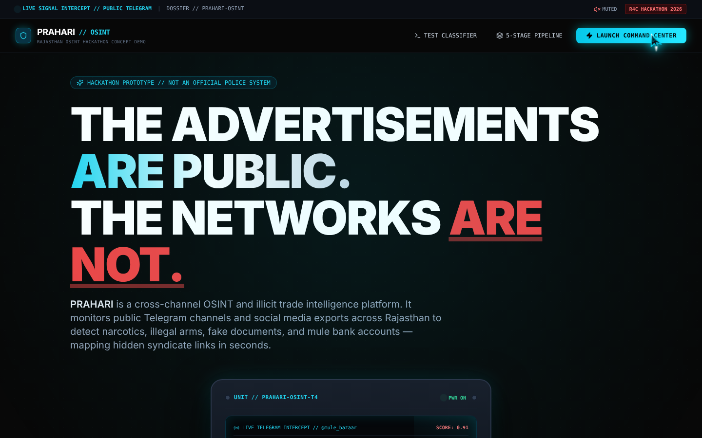
- Judge sees: A boot animation (it also wakes the backend), then an editorial page: problem, numbers (232 terms, about 2 s for 500 posts, 41 districts), five-stage pipeline, a classifier test box, topology preview and the button LAUNCH COMMAND CENTER.
- You click: Scroll once to the numbers and pipeline, then press LAUNCH COMMAND CENTER.
- You say: 'Public ads are easy to find; linking them is hard. This is the five-stage pipeline that does the linking.'
- Behind the scenes: App.tsx shows EditorialShowcase first. checkHealth() pings GET /api/health to wake Render. The test box on this page runs the browser rule engine (utils/detectionEngine.ts), not the backend.
- Note: Do not use the landing test box to demo false-alarm handling; use Import Intel > Raw Slang Scanner, which uses the backend.

### 3.2 Command Center
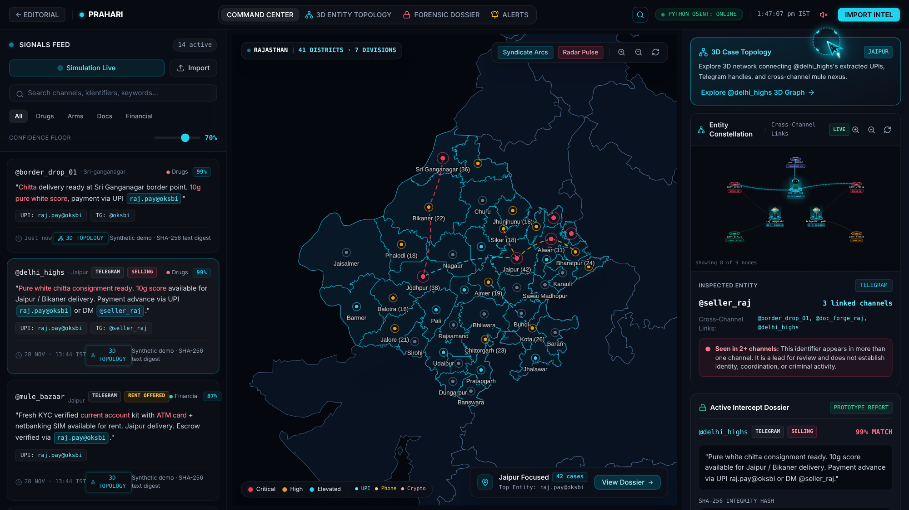
- Judge sees: Left: signals feed with category filter, confidence floor (default 70%), search, and badges for platform (TELEGRAM) and direction (SELLING, RENT OFFERED). Centre: map of the 41 Rajasthan districts with threat pins. Right: case topology card, a small live entity graph (LIVE badge) and the dossier panel.
- You click: Click @delhi_highs in the feed, then a district on the map, then a node in the small graph.
- You say: 'Every card shows why it was flagged: matched slang in red, identifiers as chips, whether it is selling or renting, and a label saying it is synthetic demo data.'
- Behind the scenes: Feed from GET /api/feed and WebSocket /ws/stream. The small graph polls GET /api/graph every 10 s and refreshes on new posts; it shows SAMPLE only if the backend cannot be reached. Simulation Live adds synthetic browser posts every 12 s.
- Note: Identifier chips: UPI = cyan, TEL = amber, BANK and IFSC = emerald, CRYPTO = purple, TG = sky. Known glitch: simulated (browser) posts can show a TG chip such as @oksbi taken from inside a UPI ID; posts analysed by the backend do not.

### 3.3 Import Intel
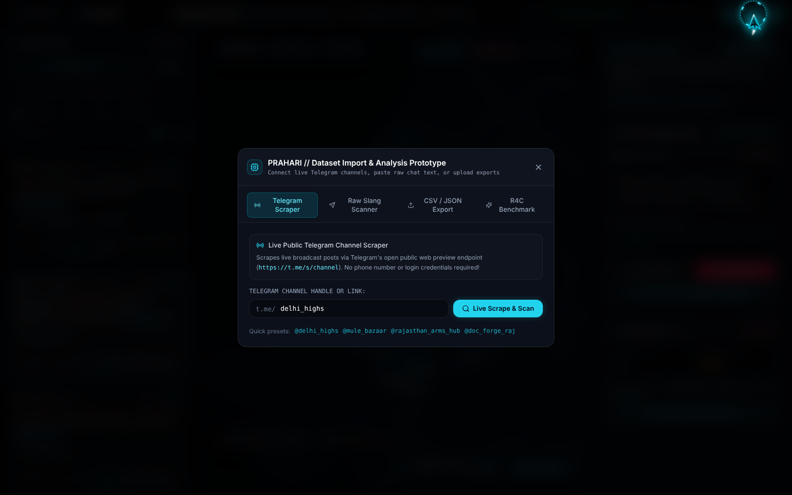
- Judge sees: A dialog with five tabs: Telegram Scraper, Raw Slang Scanner, CSV / JSON Export, Screenshot / Image, R4C Benchmark (4 synthetic posts).
- You click: Raw Slang Scanner: paste the mule-account ad and press scan; then close the dialog.
- You say: 'Same pipeline for a pasted post, an uploaded file, a screenshot or a public channel.'
- Behind the scenes: Scraper: POST /api/scan/channel. Scanner: POST /api/scan/text. File: POST /api/ingest/file. Image: POST /api/ingest/image. Each ends in process_and_store_post: classify, extract, direction, district, SHA-256, duplicate check, SQLite, graph, audit entry, WebSocket broadcast.
- Note: Suggested paste: Selling fully KYC verified current account with ATM card + net-banking kit. Rs 15000. UPI raj.pay@oksbi (expected FINANCIAL 0.99). Re-importing the same file reports 'duplicates skipped'.

### 3.4 Screenshot / Image tab
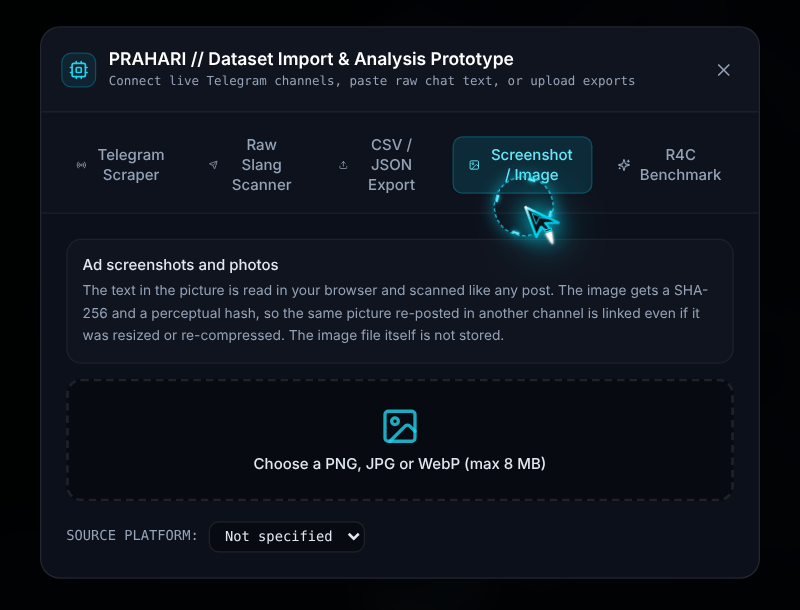
- Judge sees: A file picker for PNG, JPG or WebP (max 8 MB) and a platform selector.
- You click: Optional: upload a prepared ad poster; show the extracted text and the alert it creates.
- You say: 'Sellers post pictures to dodge text filters. We read the text in the picture and fingerprint the picture itself, so the same poster in another channel is linked even if it is resized.'
- Behind the scenes: The browser runs OCR (tesseract.js, assets bundled with the site, no CDN) and sends the text with the file. The backend stores the SHA-256 and a 64-bit perceptual hash (dHash), not the image, then runs the normal pipeline and links images within distance 10.
- Note: Only English OCR in the browser. Test your poster before the demo; do not claim OCR accuracy numbers.

### 3.5 Alerts and case workflow
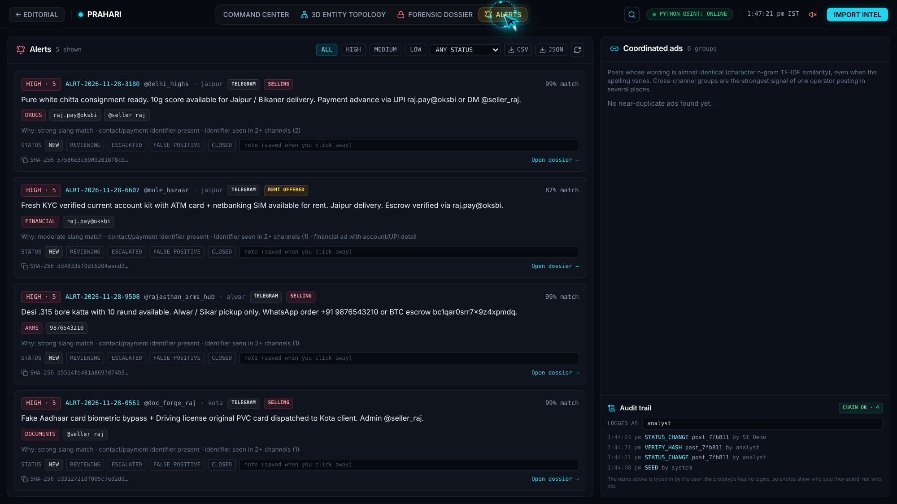
- Judge sees: Ranked alerts (ALRT-date-xxxx) with category, platform and direction badges, identifiers, 'Why:' reasons, a status row (NEW, REVIEWING, ESCALATED, FALSE POSITIVE, CLOSED) with a note box, a copyable SHA-256 and 'Open dossier'. Filters by level and status; CSV and JSON export. Right: Coordinated ads and the Audit trail with a CHAIN OK badge.
- You click: Type your name in LOGGED AS, mark the top alert ESCALATED with a note, point at the new audit-trail line and CHAIN OK.
- You say: 'The risk score is additive and every point has a reason. The analyst decides; every decision is logged in a hash-chained trail, and changing the status never touches the evidence.'
- Behind the scenes: GET /api/alerts runs analytics.build_alerts over stored posts and attaches the analyst status. POST /api/posts/{id}/status writes the case_status table and an audit entry. GET /api/audit/verify recomputes the whole chain.
- Note: There are no logins: the name is whatever is typed. Say 'tamper-evident', never 'tamper-proof'.

### 3.6 3D Entity Topology
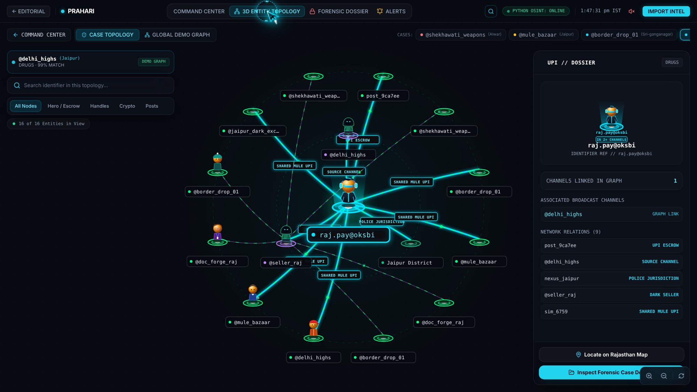
- Judge sees: A graph of the selected case: the post, its channel, district nexus and identifiers. Tabs: Case topology and Global demo graph. A side panel lists channels linked in graph and network relations.
- You click: Select @seller_raj, read 'Channels linked in graph', press 'Locate on Rajasthan Map'.
- You say: 'One handle, several channels. That is the lead an investigator would otherwise miss.'
- Behind the scenes: GET /api/graph returns nodes and edges from graph_engine.DynamicEntityGraph; the page uses it when the backend has data and otherwise shows a built-in demo graph.
- Note: The graph is a custom class, not NetworkX. A link is a lead, not proof that it is the same person.

### 3.7 Forensic Dossier and PDF
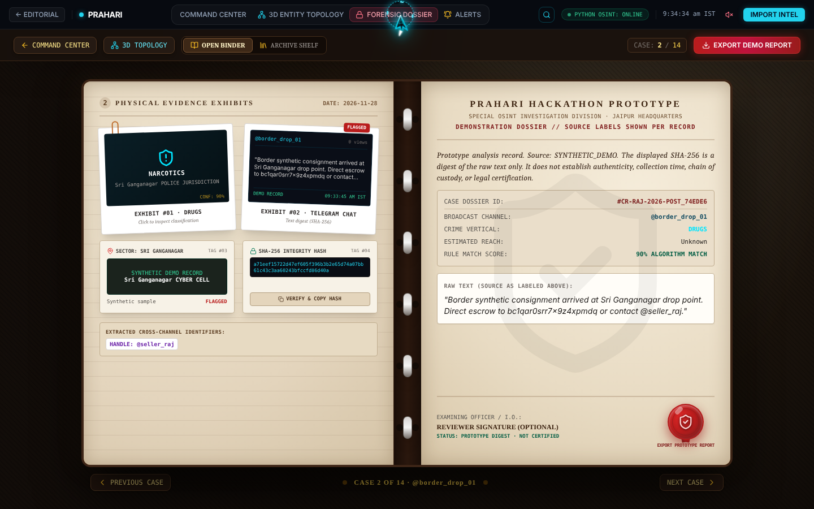
- Judge sees: A case-binder view: exhibits, the SHA-256 integrity hash with RE-VERIFY HASH and COPY HASH, raw text, extracted identifiers, and an Export Demo Report button. The PDF has four numbered sections, platform and direction, and a disclaimer.
- You click: Press RE-VERIFY HASH (shows match), then Export Demo Report.
- You say: 'The server re-hashes the stored text and compares it with the digest taken at capture. It detects edits; it is not a legal certificate, and we say so on the page.'
- Behind the scenes: POST /api/dossier/{id}/verify recomputes SHA-256 over the stored UTF-8 rawText, checks the copies agree and logs a VERIFY_HASH entry. The PDF is generated in the browser by src/utils/pdfGenerator.ts using jsPDF.
- Note: Avoid saying 'sealed', 'court-ready' or 'judicial evidence'. Under the BSA, Section 63 certification is a separate legal step.

## 4. Diagrams
### 4a. System architecture
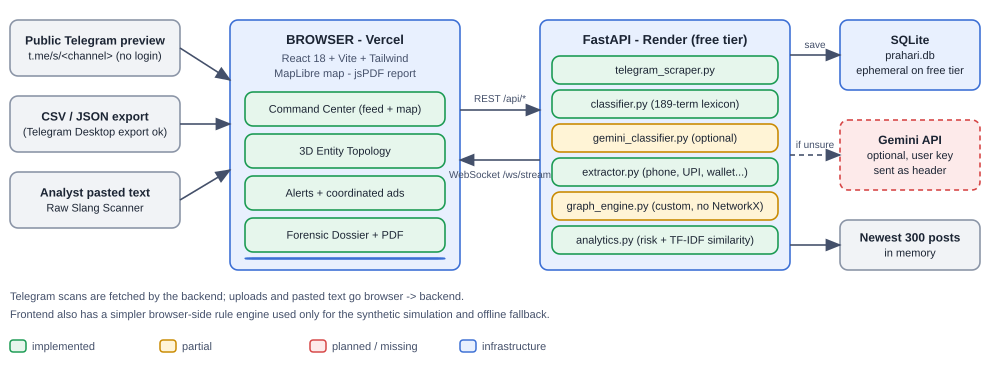

### 4b. Data pipeline
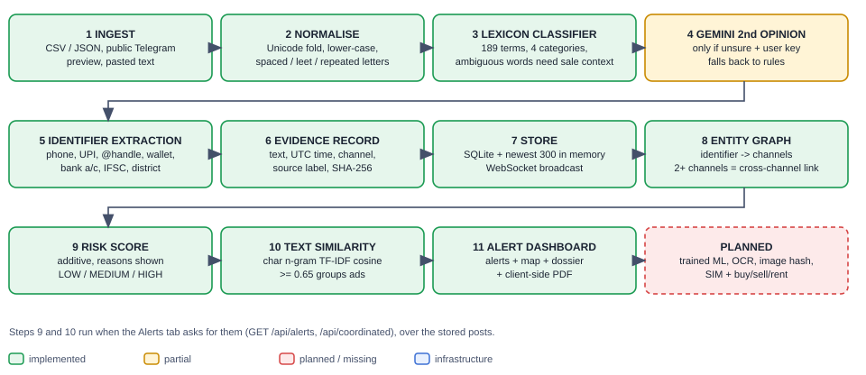

### 4c. Entity graph example
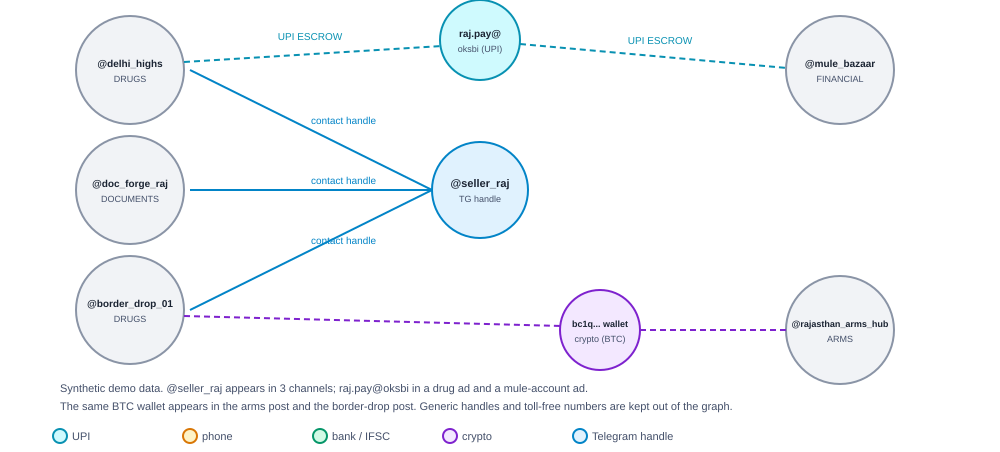

### 4d. Evidence chain
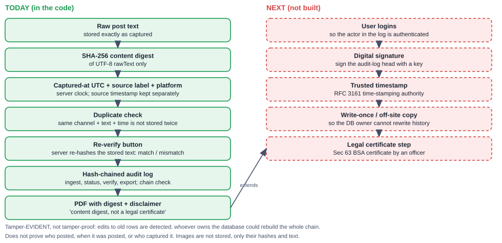

### 4e. Risk scoring
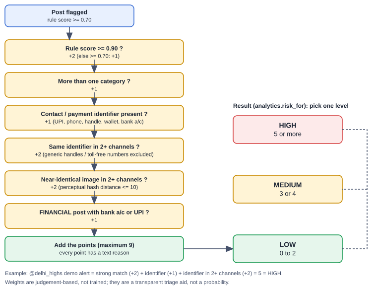

## 5. Presentation flow
| # | Slide | Time | Sentence | Speaker note | Takeaway |
|---|---|---|---|---|---|
| 1 | Hook | 0:30 | The advertisements are public; the networks are not. | Open with the problem: finding posts is easy, linking sellers is hard. | The real problem is linking, not finding. |
| 2 | By the numbers | 0:30 | 232 terms, about 2 s for 500 posts, 41 districts. | Say these are measured prototype numbers. If the deck still shows 189 / 1.5 s, update it or say the new numbers. | It is fast and we only quote what we measured. |
| 3 | Same UPI | 0:30 | One UPI can sit in a drug ad and a mule ad. | Tell the drug-ad and mule-ad story; do not say 'nobody does this'. | Identifier linking is the value. |
| 4 | Pipeline | 0:45 | Collect, classify, extract, link, alert. | Name each stage in one phrase; say the analyst stays in control. | A complete loop, not a single feature. |
| 5 | Detection engine | 0:50 | Rules + lexicon, optional AI; real outputs shown. | Say: 94.4% precision and 68.0% recall on 50 synthetic held-out posts; real-world accuracy not yet measured. | It is explainable and honest about accuracy. |
| 6 | Entity graph | 0:45 | Same identifier. Two posts. One link. | Point at the shared UPI node; mention the same picture is linked too. | Cross-channel links are visible. |
| 7 | Evidence snapshot | 0:40 | A content digest you can re-verify, and a logged trail. | Say the digest detects edits, the trail is tamper-evident, certification is a separate legal step. | We do not overclaim evidence. |
| 8 | Multilingual | 0:30 | Hindi, Hinglish, English, emoji, evasion tricks. | Read one Hinglish example and one disguised one (spaced digits). | It reads local slang and common tricks. |
| 9 | What changes | 0:30 | Less manual copying and cross-checking. | Qualitative, no multipliers. | The analyst saves effort. |
| 10 | Today vs next | 0:40 | Built today / not yet. | Say the gaps yourself: trained ML, real-data accuracy, logins, signature, scheduled monitoring. | Trust through honesty. |
| 11 | Close | 0:20 | We do not just find posts; we find networks. | Pause, then 'questions'. | Memorable close. |

### Demo click path
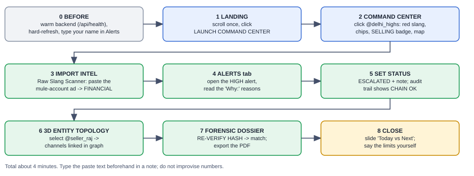

### Fallback flow
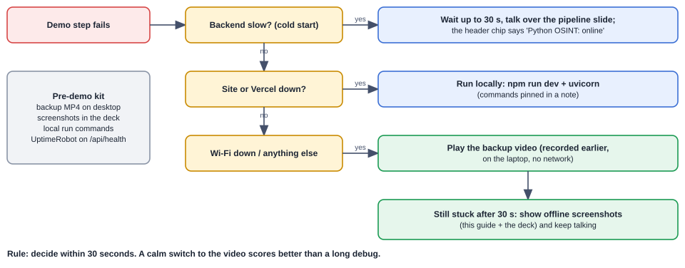

## 6. Judge Q&A bank

### A. Problem and context

**A1. What problem does PRAHARI solve?** (asked by Police officer; Easy)
- Say: Drug, arms, fake-document and mule-account sellers advertise openly on public Telegram channels in coded Hinglish. An analyst reads channel by channel and copies phone numbers and UPI IDs by hand. PRAHARI classifies those posts, extracts the seller identifiers and links the same identifier across channels so an investigator starts from a ranked alert, not a blank screen.
- Show this: Command Center: open a flagged post, show the highlighted slang and the identifier chips.
- Trap: So it replaces the analyst? -> No. It triages and collates; the analyst decides. Every alert shows its reasons and the matched words.

**A2. Why is manual monitoring not enough?** (asked by Police officer; Easy)
- Say: The problem statement itself says manual monitoring is slow, inconsistent and hard to scale, and that identifiers are rarely collated across channels. Two analysts reading the same channel may flag different posts and nobody notices that one UPI ID appears in a drug ad and a mule-account ad.
- Show this: Alerts tab: the 'identifier seen in 2+ channels' reason on a HIGH alert.
- Trap: Do you have numbers for how much time you save? -> No field study. I can state measured prototype figures only: about 2 s or less to import and score 500 posts, and about half a millisecond per post for the rules.

**A3. Who is the intended user?** (asked by Police officer; Easy)
- Say: A cyber-cell or narcotics-unit analyst who monitors public channels, and the supervisor who reads the alert list. The screens map to that: a feed to work through, an alerts list to prioritise, a graph to pivot on an identifier, and a dossier to export.
- Show this: Walk the four tabs: Command Center, 3D Entity Topology, Forensic Dossier, Alerts.
- Trap: Is it deployed with any police unit? -> No. It is a hackathon prototype. The README says built-in activity is synthetic and it is not an operational agency system.

**A4. How is this different from just searching Telegram for keywords?** (asked by Technical judge; Medium)
- Say: Keyword search returns posts. PRAHARI adds context-aware scoring (a lone keyword needs a second signal, news and warnings are not flagged), extracts structured identifiers even when disguised, groups near-duplicate ads and images, links identifiers across channels, scores risk with stated reasons and keeps a re-verifiable evidence record.
- Show this: Import Intel > Raw Slang Scanner (calls the backend): paste 'Chitta village fair on Sunday' and show it is not flagged.
- Trap: Telegram search can already do keywords. -> True for retrieval. The value here is the structured output and the cross-channel link, which search does not give.

**A5. Why Rajasthan specifically?** (asked by Police officer; Easy)
- Say: The event is Rajasthan Police. The map shows all 41 districts and the extractor recognises district names and local synonyms. The classifier and identifier logic are not Rajasthan-specific.
- Show this: Command Center map: click Jaipur, show the district panel.
- Trap: Does the district come from the post or from you? -> From the post text if a district name appears, or from a hint on import. Otherwise 'unknown'. It is not geolocation.

**A6. What is a mule account and why do you target it?** (asked by Police officer; Easy)
- Say: A mule account is a bank account whose holder rents or sells it so fraud proceeds can be moved through it. The problem statement lists sale and rent of accounts, ATM cards and SIM cards. Our FINANCIAL category covers account, ATM-card, net-banking-kit and SIM-card ads, records whether the post sells, buys or rents, and raises risk when a UPI or account detail is present.
- Show this: Alerts: open the @mule_bazaar alert; show the RENT OFFERED badge and its risk reasons.
- Trap: Do you detect SIM card sales? -> Yes, pre-activated or KYC-done SIMs offered for sale or rent are flagged as FINANCIAL. They are not a separate fifth category.

**A7. Why these four categories?** (asked by Academic; Medium)
- Say: They are the four sale types named in the problem statement: drugs, arms, fake documents, and financial (accounts, cards, kits). Keeping four classes made the lexicon curation and the evaluation tractable in the time available.
- Show this: Landing page category strip: DRUGS, ARMS, DOCUMENTS, FINANCIAL.
- Trap: What about other crimes, e.g. human trafficking? -> Out of scope here. The design is a lexicon plus rules, so a new category is a new dictionary group, but it would need its own evaluation.

**A8. What does 'collating seller identifiers' mean in practice?** (asked by Police officer; Easy)
- Say: Each phone, UPI, handle and wallet becomes a graph node, lower-cased so the same ID written differently merges. When the same node appears under two or more channels it is marked as a cross-channel link and adds to the risk score.
- Show this: Topology: select @seller_raj and show the channels linked in the graph panel.
- Trap: Could two unrelated sellers share a node by accident? -> Less now: generic handles like @admin, toll-free and placeholder numbers go to a 'shared' list and are never linked. A reused real number could still create a false link, so a link is a lead, not proof.

**A9. Can you quantify your impact?** (asked by Police officer; Medium)
- Say: Not in the field. What I can show are measured prototype numbers: 232 lexicon terms, 41 districts, 500 posts imported and scored in about 2 s or less, and precision and recall on a 50-post synthetic held-out set. I will not quote a time-saving percentage without a study.
- Show this: README accuracy section and backend/eval_classifier.py output.
- Trap: Your slides earlier said 100X reach. -> That wording was an estimate, not a measurement, so it was removed from the deck and the website.

**A10. Is this production-ready?** (asked by Police officer; Easy)
- Say: No. It is a hackathon prototype on free hosting with no logins, a SQLite file and a labelled-synthetic demo dataset. It now has an analyst status workflow and a hash-chained audit trail, but authentication, signed logs and a classifier evaluated on real labelled data come before any pilot.
- Show this: Slide 'Today vs Next'.
- Trap: So why should we trust it? -> Because it shows its work: matched words, risk reasons, a content digest you can re-verify, a logged trail, and honest limits on every screen.

**A11. What is unique about your approach?** (asked by Technical judge; Medium)
- Say: Three things: context-aware slang rules that avoid flagging ordinary words and see through common disguises, a transparent additive risk score where every point has a stated reason, and cross-channel linking by identifier and by image, presented on a district map. Plus a deliberately honest evidence record you can re-verify.
- Show this: Alerts list 'Why:' lines under each alert.
- Trap: Is any of it novel research? -> No. It is an engineering combination for a specific workflow, not a new algorithm.

**A12. What would you build with another month?** (asked by Academic; Medium)
- Say: In order: evaluate on the R4C labelled set with a separate tuning split; train a simple classifier (for example TF-IDF plus logistic regression) next to the rules and report both; user logins so the audit trail is authenticated; sign the audit-log head; scheduled scans of a watch-list of public channels; Hindi OCR.
- Show this: Slide 'Today vs Next'.
- Trap: Why the evaluation first? -> Because every other change is tuned against it, and our current numbers are on synthetic data only.

**A13. Did the organisers give you data? What did you test on?** (asked by Police officer; Medium)
- Say: We built and tested on synthetic posts we wrote ourselves, which the problem statement allows, and we never used real personal data. If the R4C labelled sample is provided, we import it through the same CSV/JSON path and report precision and recall on it separately.
- Show this: Import Intel > CSV / JSON; Appendix B method.
- Trap: So your 94% means nothing? -> It means the rules work on the cases we designed; it does not predict real-world accuracy, which is why we always say 'synthetic'.

### B. Data collection, scope and ethics

**B1. How do you collect from Telegram?** (asked by Technical judge; Easy)
- Say: The backend requests the channel's public web preview at t.me/s/<name>, parses the posts with BeautifulSoup and runs each through the same pipeline as imported data. No phone login or credentials are involved.
- Show this: Import Intel > Telegram Scraper tab; type a public channel handle.
- Trap: Why not Telethon or the Bot API? -> They need an account or bot membership. Using one would mean credentials or a fake identity, which the problem statement puts out of scope. An authorised collector is a future item.

**B2. Can it read private groups or channels?** (asked by Police officer; Easy)
- Say: No. It only reads what is publicly visible without logging in. It does not join groups, use fake identities or contact sellers, matching the out-of-scope list.
- Show this: Show the scraper code path: only t.me/s public preview.
- Trap: What if a channel has no public preview? -> The request returns an error and the UI says no live posts were collected. It never reports an empty channel as a result.

**B3. Do you ever interact with sellers?** (asked by Police officer; Easy)
- Say: Never. There is no messaging or purchasing capability anywhere in the code. Identifiers are only extracted and shown.
- Show this: Point to the API list: there is no send or contact endpoint.
- Trap: Could someone add that later? -> Technically yes, which is why the scope statement is part of the README and the demo script.

**B4. What import formats are supported?** (asked by Technical judge; Easy)
- Say: CSV, JSON and Telegram Desktop exports. The importer detects delimiter, accepts text, message, rawText or raw_text columns, flattens Telegram's rich-text arrays, and limits a file to 500 records and 10 MB.
- Show this: Import Intel > CSV / JSON Export; drop a sample file.
- Trap: What if I upload 5,000 rows? -> It is rejected with a 413 message. The limit protects the free-tier server.

**B5. Does it monitor channels continuously?** (asked by Police officer; Medium)
- Say: Not yet. Collection is on demand: you scan a channel or import a file. The 'Simulation Live' feed you see is synthetic demo traffic and is labelled as such. Scheduled collection is a next step.
- Show this: Command Center: the 'Simulation' toggle and the source label under each post.
- Trap: So '24x7 monitoring' on the slide is not true? -> Correct, which is why the deck does not claim it. We say 'monitor on demand, scan and import'.

**B6. What about Instagram and other platforms?** (asked by Police officer; Medium)
- Say: Not collected directly. Posts exported from any platform can be imported as CSV or JSON, and each record now carries a platform field (Telegram, WhatsApp, Instagram, Facebook, X, OLX, Quikr, other or unknown) that shows as a badge.
- Show this: Import modal: the platform selector; a TELEGRAM badge on a feed card.
- Trap: Will it handle Instagram images? -> Screenshots can be uploaded in the image tab: the text is read in the browser and the picture is fingerprinted. There is no Instagram collector.

**B7. What if Telegram changes its preview page?** (asked by Technical judge; Hard)
- Say: The parser depends on Telegram's HTML class names, so a change would break it. In that case the request returns a clear 502 error rather than silent empty data, and CSV/JSON import still works as the stable path.
- Show this: backend/telegram_scraper.py: TelegramPreviewError handling.
- Trap: Why not a more robust API? -> The official APIs need authenticated access; the public preview is the only no-credential route.

**B8. Is scraping a public preview legal?** (asked by Legal expert; Hard)
- Say: I am not a lawyer. The collector only reads content that is visible to anyone without logging in and stores text, not accounts' private data. For real investigations the lawful route is the agency's own authority and legal process; this prototype is for the hackathon only.
- Show this: README prototype notice.
- Trap: What about Telegram's terms of service? -> They would need to be reviewed by counsel before any operational use. I would not claim compliance.

**B9. What data do you store?** (asked by Legal expert; Medium)
- Say: Per post: text, channel, categories, confidence, matched terms, extracted identifiers, district, a SHA-256 digest, source type and capture time, in a SQLite file. Demo data is synthetic. No credentials are stored, and an optional Gemini key is never stored.
- Show this: Dossier panel fields for one post.
- Trap: Is the SQLite file protected? -> Not beyond the host. It is mutable and not encrypted; that is why the digest is described as a change-detector, not a seal.

**B10. Is the data in the demo real?** (asked by Police officer; Easy)
- Say: No. The five seed posts and the simulated stream are synthetic and carry a SYNTHETIC_DEMO source label. Posts scanned from Telegram or imported are labelled with their real source type.
- Show this: Any post: the source label line ('Synthetic demo', 'Telegram preview').
- Trap: Why do the seller handles look real? -> They are invented demo handles such as @seller_raj. We do not use real personal data.

**B11. Do you handle images or posters?** (asked by Police officer; Medium)
- Say: Yes, at prototype level. In Import Intel > Screenshot / Image the browser reads the text (OCR with tesseract.js), the backend stores the file's SHA-256 and a perceptual hash, runs the normal pipeline on the text, and links near-identical pictures across channels. The image itself is not stored.
- Show this: Import Intel > Screenshot / Image tab.
- Trap: How accurate is the OCR? -> Not measured. It is English-only in the browser and works best on clear text; we would evaluate it on the R4C sample posters.

**B12. What are the size and rate limits?** (asked by Technical judge; Medium)
- Say: A single text scan is capped at 50,000 characters, an import at 500 records and 10 MB, and a channel scan at 50 posts. The server keeps the newest 300 posts in memory and writes all of them to SQLite.
- Show this: backend/main.py request models.
- Trap: Why 300 in memory? -> Simplicity on a free tier. The graph and similarity run in memory, so a small cap keeps them fast.

### C. Classifier and NLP

**C1. How does the classifier work?** (asked by Technical judge; Medium)
- Say: A curated lexicon of 232 terms across four categories, in English, Hinglish, Devanagari and emoji. A strong term alone is not enough: it needs sale context or a second, different concept. Ambiguous terms such as 'ice' or 'pistol' count only in a sale context. News, warnings and ordinary shop notices are suppressed. A flag needs a score of at least 0.70.
- Show this: Import Intel > Raw Slang Scanner: 'desi katta available' (flags) and 'pistol shooting class' (does not).
- Trap: What is a strong versus an ambiguous term? -> Strong: 'chitta', 'desi katta'. Ambiguous: ordinary words like 'ice' or 'pistol' that need sale context.

**C2. Is it machine learning?** (asked by Technical judge; Hard)
- Say: Honestly: the classifier is rule-based, a lexicon plus context rules; nothing is trained on data. ML-style parts are around it: TF-IDF character n-grams for ad similarity, a perceptual hash for images, OCR (a trained network we use as a tool), and an optional Gemini LLM second opinion. The problem statement says lexicon plus ML, so the ML side is partial.
- Show this: backend/classifier.py and requirements.txt.
- Trap: Why not train one? -> We had no labelled real data. With a few hundred labelled posts, such as the R4C sample, a TF-IDF plus logistic-regression model can sit next to the rules, and we would report both.

**C3. What does the confidence number mean?** (asked by Academic; Medium)
- Say: It is a rule-match score, not a calibrated probability. It comes from the weight of the best matched term, capped for ambiguous terms, with a small bonus for extra matches, up to 0.99.
- Show this: Dossier: 'Rule match score'. PDF says 'rule match score'.
- Trap: So 0.87 is not 87% likely? -> Correct. Calibration would need labelled data and a method such as isotonic regression. That is to be measured.

**C4. How do you handle Hinglish and Hindi?** (asked by Police officer; Medium)
- Say: The lexicon contains romanised Hinglish ('maal', 'kiraya pe', 'raund') and Devanagari terms. Text is Unicode-normalised first so fullwidth or decorated letters fold to plain ones.
- Show this: Raw Slang Scanner: try 'देशी कट्टा available' and 'account kiraya pe'.
- Trap: What about spelling variants? -> Repeated letters, spaced-out letters and simple number-for-letter swaps are handled for plain-letter terms. Genuinely new slang is not.

**C5. How do you treat emojis?** (asked by Police officer; Medium)
- Say: Emojis are lexicon entries with moderate weights and marked ambiguous, so an emoji alone does not flag a post. It counts only with sale context or another matched term.
- Show this: Raw Slang Scanner: a lone 🔥 versus '🔥 chitta available'.
- Trap: Can emoji codes change quickly? -> Yes. The dictionary is editable text, but it needs ongoing curation.

**C6. Can sellers beat it with obfuscation?** (asked by Technical judge; Hard)
- Say: Common tricks are handled: spaced or spelled-out digits, Devanagari and full-width digits, look-alike Cyrillic or Greek letters, zero-width characters, leetspeak and 'name (at) upi'. Our 45 hand-written evasion cases pass. But those are tricks we thought of; new coded words that are not in the lexicon still get through.
- Show this: Raw Slang Scanner: 'chitta available, call nine eight seven six five four three two one zero' flags DRUGS and extracts 9876543210.
- Trap: So it is robust? -> Against the listed tricks, yes. Against unknown slang, no; that needs new terms or a trained model.

**C7. What is your false-positive rate?** (asked by Technical judge; Medium)
- Say: On the 50-post held-out set, 1 of the 18 flagged posts was wrong: 'Bhai kal party hai, maal ready rakhna, cold drinks bhi'. That gives 94.4% precision on a tiny synthetic set, so the real rate is uncertain.
- Show this: Run backend/eval_classifier.py and show the HOLDOUT lines.
- Trap: Why did that one flag? -> 'maal' plus 'ready' reads like a sale offer to the rules. Party slang is genuinely ambiguous; an analyst marks it FALSE POSITIVE.

**C8. What does Gemini do and when is it called?** (asked by Technical judge; Medium)
- Say: Only if the user entered a key. The lexicon runs first; a confident hit is kept and Gemini is not called. When the lexicon is unsure or finds nothing, Gemini returns a category, confidence and reason. A confident 'harmless' can veto a weak keyword flag. Any failure falls back to the lexicon.
- Show this: AI settings on the landing page; 'AI-assisted' label on a post.
- Trap: Is the post text sent to Google? -> Yes, only when a key is supplied and the post is unsure. Without a key nothing leaves the server.

**C9. Why not use an LLM for everything?** (asked by Technical judge; Medium)
- Say: Cost, latency, privacy and explainability. The rules are deterministic, about half a millisecond per post, and show which words matched. An LLM adds a second opinion where rules are unsure, but is optional.
- Show this: Latency line in the eval output: about 0.4 to 0.5 ms per post for rules.
- Trap: Would an LLM-only approach score higher? -> Possibly on recall for new slang. It was not measured, so I will not claim it.

**C10. How explainable is a flag?** (asked by Police officer; Medium)
- Say: The matched words are highlighted in red inside the post, listed in the dossier and in the PDF, and the alert shows each risk reason. A reader can see exactly why it was flagged.
- Show this: Command Center post card: red highlighted terms.
- Trap: Can the analyst correct a wrong flag? -> Yes: mark it FALSE POSITIVE with a note in the Alerts tab; that is logged in the audit trail.

**C11. How do you add new slang?** (asked by Police officer; Easy)
- Say: Edit the SLANG_DICTIONARY in the backend, choose a weight, and mark it ambiguous if the word has everyday meanings. No retraining is needed.
- Show this: backend/classifier.py top of file.
- Trap: Who maintains it? -> That is an operational question. The R4C labelled examples would seed it, and analysts would feed new terms.

**C12. Is the browser classifier the same as the server's?** (asked by Technical judge; Hard)
- Say: No. The frontend has a simpler separate rule engine used for the synthetic simulation and as an offline fallback; such posts carry LOCAL_ANALYSIS or SYNTHETIC_DEMO labels. Real scans and imports go to the backend classifier, which is the authoritative one.
- Show this: utils/detectionEngine.ts versus backend/classifier.py.
- Trap: Doesn't that give inconsistent results? -> It can, which is why those records are labelled and why unifying them is a cleanup item.

**C13. Is 94.4% precision your real-world accuracy?** (asked by Technical judge; Hard)
- Say: No. It is precision on 50 synthetic held-out posts. Recall on the same set is 68%. Real posts are messier: code-mixed, misspelt, with slang we have not seen. Real-world accuracy is not yet measured.
- Show this: eval_classifier.py HOLDOUT line; say n=50 aloud.
- Trap: Then why put it on the website? -> Because it is a measured number with its conditions stated; we never present it without 'synthetic'.

**C14. What happens when sellers invent new slang tomorrow?** (asked by Police officer; Medium)
- Say: The rules miss it until the term is added, which takes minutes and is covered by tests. The optional Gemini second opinion can catch some unseen wording. Analysts marking FALSE POSITIVE or adding missed posts gives us the list to update next.
- Show this: classifier.py SLANG_DICTIONARY and the test that counts terms.
- Trap: Does it learn automatically? -> No. Updates are manual and reviewed; automatic retraining needs labelled data and a trained model.

### D. Financial-ad detector and risk scoring

**D1. How do you detect mule-account and ATM-card ads?** (asked by Police officer; Easy)
- Say: The FINANCIAL group of the lexicon covers phrases such as 'KYC verified account', 'account kiraya pe', 'ATM kit', 'net-banking kit' and 'mule account'. Generic words like 'current account' are weak on their own and only count with other signals, which cuts false alarms.
- Show this: Raw Slang Scanner: 'Selling fully KYC verified current account with ATM card + net-banking kit. ₹15000. UPI raj.pay@oksbi' gives FINANCIAL 0.99.
- Trap: Does 'I opened a current account' flag? -> No: 'current account' alone is weak (0.60) and below the 0.70 flag threshold.

**D2. Do you detect SIM card sales?** (asked by Police officer; Medium)
- Say: Yes. Phrases for pre-activated, KYC-done or bulk SIM cards offered for sale or rent are in the FINANCIAL group, and the direction field says whether it is a sale or a rental.
- Show this: Raw Slang Scanner: 'pre-activated SIM cards for sale, KYC done, bulk rate' gives FINANCIAL.
- Trap: Why not a separate SIM category? -> The problem statement groups SIMs with mule-account trade, so we kept four categories and used the matched terms to show it is a SIM ad.

**D3. Can you tell buying from selling from renting?** (asked by Police officer; Medium)
- Say: Yes, as a keyword hint. Each post gets a direction: SELL, BUY, RENT_OFFER, RENT_WANTED or UNKNOWN, shown as a badge such as SELLING or RENT OFFERED and printed in the PDF.
- Show this: Feed card for @mule_bazaar: the RENT OFFERED badge.
- Trap: Is direction reliable? -> It is a hint from words like 'chahiye', 'for sale', 'kiraye pe'; it is not used in the risk score and an analyst should confirm it.

**D4. How is the risk level computed?** (asked by Technical judge; Medium)
- Say: A transparent additive score. +2 for a strong rule match (0.90+), +1 for moderate, +1 for more than one category, +1 if a contact or payment identifier is present, +2 if an identifier is seen in two or more channels, +2 if a near-identical image is seen in two or more channels, +1 for a financial ad with account or UPI detail. 5 or more is HIGH, 3 or 4 MEDIUM, else LOW.
- Show this: Alerts tab: read the 'Why:' line under an alert.
- Trap: Why those weights? -> They are judgement-based and not trained. They should be checked against R4C labels; I would not call them optimal.

**D5. What makes an alert HIGH?** (asked by Police officer; Medium)
- Say: A strong slang match plus a contact identifier plus that identifier appearing in a second channel already gives 5 points. In the demo data the @delhi_highs alert is HIGH for exactly that reason.
- Show this: Alerts tab: the HIGH alert for @delhi_highs with its reasons.
- Trap: Could a harmless post become HIGH? -> Only if it matches strongly and shares a real identifier. Generic handles and toll-free numbers no longer add the cross-channel points.

**D6. Can the analyst change status or override the risk?** (asked by Police officer; Medium)
- Say: Yes. Each alert has a status: NEW, REVIEWING, ESCALATED, FALSE POSITIVE or CLOSED, with a note. The change is written to a separate table and to the audit trail; the evidence record and its hash are never changed. The risk score itself is not overridden, so the original reasoning stays visible.
- Show this: Alerts: set ESCALATED with a note, then show the new audit-trail line.
- Trap: Who changed it? -> Whoever typed their name in 'Logged as'. There are no logins yet, so the trail records who said they acted, and we say so on the screen.

**D7. Does it use price or amount?** (asked by Technical judge; Easy)
- Say: No. Amounts are not parsed or used in scoring. They remain visible in the raw text.
- Show this: Dossier raw text panel.
- Trap: Would price help? -> Possibly as a feature, but it needs data to prove it.

**D8. Walk me through a worked example.** (asked by Technical judge; Medium)
- Say: Take the demo alert for @border_drop_01. Its strong slang match scores 0.99, which gives +2. It contains a wallet and a handle, so +1 for an identifier. The handle @seller_raj is also seen in other channels, so +2. Total 5, which is HIGH. The alert lists exactly those three reasons.
- Show this: Alerts tab: open the border-drop alert and read the 'Why:' line: strong slang match; contact/payment identifier present; identifier seen in 2+ channels.
- Trap: Does the arithmetic match the screen? -> Yes: 2 + 1 + 2 = 5. Always read the on-screen reasons; each maps to one rule in analytics.risk_for.

**D9. What stops one noisy keyword from creating HIGH?** (asked by Technical judge; Hard)
- Say: Two layers. A single strong keyword no longer flags by itself; it needs sale context or a second, different concept. And HIGH needs several independent signals. Shared or generic identifiers do not add the cross-channel points.
- Show this: Raw Slang Scanner: 'Chitta village fair on Sunday' is not flagged.
- Trap: Then what still slips through? -> Party or slang phrases that genuinely read like an offer, such as 'maal ready rakhna'. That is our one held-out false positive.

**D10. How would you validate the risk levels?** (asked by Academic; Hard)
- Say: With the R4C labelled set: have analysts rank a sample by true priority and compare it to our order using precision at k and rank correlation, then adjust weights on one split and test on another.
- Show this: Describe the method; no result yet ('to be measured').
- Trap: Have you done that? -> No. I state it as the method, not a result.

**D11. Does the risk use image or network features?** (asked by Technical judge; Medium)
- Say: Yes, simply: +2 when the same identifier appears in two or more channels, and +2 when a near-identical image (perceptual-hash distance 10 or less) appears in two or more channels.
- Show this: Risk reasons list.
- Trap: So centrality is used? -> No. No centrality or community detection, only channel counts.

**D12. Why not a trained risk model?** (asked by Academic; Medium)
- Say: No labelled risk data exists yet, and an explainable additive score is easier to defend to an officer or a court than an opaque model. A trained model could come once labels exist.
- Show this: The reasons line in an alert.
- Trap: Isn't explainability just a slogan? -> Here it is concrete: every point has a text reason shown in the UI.

### E. Identifier extraction

**E1. What identifiers do you extract?** (asked by Police officer; Easy)
- Say: Indian mobile numbers, UPI IDs, Telegram @handles, crypto wallets (BTC, ETH, TRON), bank account numbers, IFSC codes and a Rajasthan district name. They appear as colour-coded chips.
- Show this: Command Center post card chips: UPI cyan, TEL amber, BANK/IFSC emerald, CRYPTO purple, TG sky.
- Trap: Locations beyond districts? -> No general geoparsing; just district names and local synonyms.

**E2. How are phone numbers extracted?** (asked by Technical judge; Easy)
- Say: A regex for Indian mobiles starting 6–9, with optional +91, 91 or 0 prefix and spaces, dots or dashes. They are normalised to the last 10 digits.
- Show this: Raw Slang Scanner: '+91 98765 43210' appears as TEL: 9876543210.
- Trap: Do spelled-out numbers work? -> No.

**E3. How do you tell a UPI ID from an email or a Telegram handle?** (asked by Technical judge; Medium)
- Say: A linear scan around each '@' finds UPI-shaped matches and separately detects email addresses to exclude them. Handles that are just the UPI suffix are dropped.
- Show this: Raw Slang Scanner: a post with both raj.pay@oksbi and @seller_raj gives one UPI chip and one TG chip.
- Trap: Is it exact? -> No. It is a heuristic; unusual forms can be missed or mis-split.

**E4. Why did you rewrite the UPI regex?** (asked by Technical judge; Hard)
- Say: A crafted input like 'a.a.a.a…@x' of about 50 KB took roughly 8 seconds with the old regex and froze the server. The new single linear pass has bounded work per '@', and a request is capped at 50,000 characters.
- Show this: backend/extractor.py docstring of _find_at_matches.
- Trap: Is it safe against all hostile input? -> Not proven, but that known quadratic case is fixed and there are regression tests.

**E5. Which crypto wallets are recognised?** (asked by Technical judge; Easy)
- Say: Bitcoin (bc1 and legacy 1/3 forms, including short bc1 strings in the demo), Ethereum 0x-addresses and TRON T-addresses. They show as purple CRYPTO chips and link in the graph.
- Show this: The @rajasthan_arms_hub seed post: its bc1q wallet chip.
- Trap: Are wallet addresses validated by checksum? -> No, pattern only.

**E6. Can bank account numbers be confused with other numbers?** (asked by Technical judge; Medium)
- Say: Yes. Any 9 to 18 digit string that is not already a phone number is treated as a bank account number, so reference numbers could be mislabelled. That is a precision limit.
- Show this: Raw Slang Scanner with a long numeric reference.
- Trap: Do you validate IFSC against a bank list? -> No, only the 4-letter + 0 + 6-character pattern.

**E7. Are identifiers normalised before linking?** (asked by Technical judge; Medium)
- Say: Yes. Phones become ten digits, including spaced, dashed, spelled-out and non-English digits. UPI IDs, handles and 0x wallets are lower-cased, so Raj.Pay@OKSBI and raj.pay@oksbi are one node. 'name (at) oksbi' is rebuilt as a UPI for known UPI hosts.
- Show this: Graph node ids in /api/graph.
- Trap: Does that change the stored text? -> No. Normalisation runs on a copy; the raw text and its hash stay exactly as captured.

**E8. What about locations?** (asked by Police officer; Easy)
- Say: The extractor checks 41 Rajasthan district names and nearby synonyms and takes the first match. If none is found the district is 'unknown' and the post is counted separately.
- Show this: Map: the 'unlocated' counter after an import.
- Trap: Could two districts appear in a post? -> Yes; the first matching district wins.

**E9. Do you extract from images?** (asked by Technical judge; Medium)
- Say: Yes: the text read from a screenshot goes through the same extractor, so phones, UPIs and handles in a poster become chips and graph nodes.
- Show this: Import Intel > Screenshot / Image.
- Trap: Does the server do OCR? -> Only if the tesseract program is installed. The free Render tier does not have it, so the browser does the OCR there.

**E10. How do you avoid leaking personal data?** (asked by Legal expert; Medium)
- Say: The demo uses synthetic identifiers. For real data the app only handles what sellers publish publicly in their own ads. There is no user login or profile data.
- Show this: README prototype notice.
- Trap: Is a seller's phone number personal data? -> Likely, so a real deployment needs access control and retention rules, which the prototype does not have.

**E11. What if an identifier appears in the text with extra characters?** (asked by Technical judge; Medium)
- Say: Spaces, dots and dashes inside numbers are handled; unusual separators or words may not be.
- Show this: Raw Slang Scanner with '98765-43210'.
- Trap: Is that tested? -> There are unit tests for the extractor in backend/test_ingestion.py.

**E12. Can analysts use the identifiers directly?** (asked by Police officer; Easy)
- Say: Yes. Each chip copies its full value on click, the global search (Ctrl/Cmd+K) finds a UPI, phone, handle, wallet or district, and the dossier PDF lists them.
- Show this: Click a chip then press Ctrl+K and search it.
- Trap: Is the search over all data? -> Over the posts loaded in the browser, not the whole database.

**E13. What is the 'shared identifiers' list?** (asked by Technical judge; Medium)
- Say: Identifiers that many unrelated people use, such as @admin or @support, toll-free numbers like 1800..., and all-same-digit placeholders. They are kept on the post but never become graph nodes, so they cannot create false cross-channel links or false risk points.
- Show this: A post mentioning @admin: shown under shared identifiers.
- Trap: Can a unit add its own? -> Yes, through the PRAHARI_SHARED_IDENTIFIERS environment variable on the backend.

**E14. How do you handle a phone number written in words or with spaces?** (asked by Police officer; Easy)
- Say: Extraction runs on a normalised copy: spaced, dashed, spelled-out English or Hindi digit words, Devanagari and full-width digits all become a ten-digit number. The stored text is unchanged.
- Show this: Raw Slang Scanner: '... call nine eight seven six five four three two one zero' gives 9876543210.
- Trap: And a bank account number with a phone-like tail? -> Fixed: the phone pattern no longer takes the last ten digits out of a longer account number.

### F. Link analysis and entity graph

**F1. How do you link posts across channels?** (asked by Technical judge; Easy)
- Say: Each identifier is a node keyed by its value. A post connects to the identifiers it contains. When the same identifier node is reached from two or more channels, it is marked as a cross-channel link and raises risk.
- Show this: Topology: @seller_raj with edges to posts in several channels.
- Trap: Is that link proof of one criminal? -> No. It is a lead for an investigator; shared or reused identifiers can mislead.

**F2. Show a link across channels.** (asked by Police officer; Easy)
- Say: In the synthetic seed data the handle @seller_raj appears in three channels: @delhi_highs (drugs), @doc_forge_raj (documents) and @border_drop_01 (drugs). The UPI raj.pay@oksbi also appears in a drug and a mule-account ad.
- Show this: Topology tab > select @seller_raj; check 'Channels linked in graph'.
- Trap: Is that real? -> It is invented demo data built to show the feature.

**F3. How does text similarity work?** (asked by Technical judge; Medium)
- Say: Character n-gram TF-IDF (3 to 5 characters) with cosine similarity. Pairs at 0.65 or above are merged into groups with union-find, which is robust to Hinglish spelling variants. The Alerts tab shows these as Coordinated ads. Exact re-imports are removed earlier by the duplicate check.
- Show this: Alerts tab > Coordinated ads panel.
- Trap: Why 0.65? -> A starting value; it can be changed per request (/api/coordinated?threshold=). It should be tuned on labelled duplicates.

**F4. Do you compare images?** (asked by Technical judge; Medium)
- Say: Yes. Each uploaded image gets a 64-bit difference hash. Two images within 10 bits of each other are treated as the same picture resized, re-compressed or lightly edited, linked with a SIMILAR IMAGE edge and counted in the risk score.
- Show this: GET /api/image-matches, or upload the same poster twice at different sizes.
- Trap: Why not a neural image embedding? -> A perceptual hash is fast, explainable and needs no model; it catches re-posted copies, which is the main pattern. Different photos of the same product need embeddings, which is future work.

**F5. Is NetworkX used for the graph?** (asked by Technical judge; Easy)
- Say: No. The graph is a small custom class that keeps node and edge lists in memory and is rebuilt from the database on start. There are no centrality or community algorithms yet.
- Show this: backend/graph_engine.py.
- Trap: Then what graph analysis do you do? -> Shared-identifier and similar-image linking and a count of channels per identifier. Anything more advanced is future work.

**F6. Is the graph saved?** (asked by Technical judge; Medium)
- Say: Only the posts are saved in SQLite. The graph is rebuilt in memory from the latest 300 stored posts when the backend starts.
- Show this: /api/graph returns the current graph.
- Trap: What if the server restarts? -> The graph is rebuilt, but on free hosting the SQLite file itself may be reset.

**F7. Is the topology page showing live data?** (asked by Technical judge; Hard)
- Say: It fetches the live graph from /api/graph when the backend is up and has data; otherwise it shows the built-in demo graph, labelled 'Global demo graph'. The small graph preview in the older Command Center component is static demo data.
- Show this: Topology tab: 'Case topology' versus 'Global demo graph'.
- Trap: How can I tell which I am looking at? -> The source label and node ids: demo nodes are the fixed ones; live nodes show your imported identifiers.

**F8. Can a wrong link happen?** (asked by Technical judge; Medium)
- Say: Yes, but we reduced the common cause: generic handles, toll-free and placeholder numbers are kept in a 'shared' list and never linked. A real number reused by unrelated people, or a resold SIM, could still link two sellers wrongly.
- Show this: A post with @admin: it appears under shared identifiers, not as a graph node.
- Trap: So the graph proves nothing? -> It generates leads. Evidence still needs corroboration.

**F9. How does the district map use the data?** (asked by Police officer; Easy)
- Say: Posts are counted per district from the text or hint. The map colours districts by threat level based on those counts and shows a district panel. The 'syndicate arcs' between districts come from demo connection data, not from detected relationships.
- Show this: Map: toggle 'Syndicate Arcs' and say they are demo connections.
- Trap: Do the counts include real posts? -> They count stored records, including synthetic seeds, and the API says so in countScope.

**F10. How does it scale?** (asked by Technical judge; Hard)
- Say: Poorly beyond a pilot: the newest 300 posts are held in memory, similarity compares every pair (quadratic) and SQLite is a single file. For a pilot with thousands of posts it needs a proper database and incremental similarity.
- Show this: MAX_STORED_POSTS in main.py.
- Trap: What breaks first? -> Similarity time and the single free-tier server.

**F11. Does it detect coordinated campaigns?** (asked by Academic; Medium)
- Say: Near-duplicate ads across channels are grouped; the groups with several channels are listed first. Behavioural coordination, such as posting times, is not analysed.
- Show this: Coordinated ads panel.
- Trap: Does it handle translated copies? -> No, only similar spelling.

**F12. Why a 3D topology view?** (asked by Police officer; Easy)
- Say: It lets an investigator pivot from a post to its identifiers and channels and locate the district on the map. It is a navigation aid; the analysis is the same shared-identifier linking.
- Show this: Click 'Locate on Rajasthan Map' in the topology side panel.
- Trap: Is 3D necessary? -> No; it is a presentation choice. The value is in the links.

**F13. What happens if the same file is imported twice?** (asked by Technical judge; Easy)
- Say: Duplicates are skipped. A post with the same channel, same exact text and same source timestamp is recognised and not stored again, and the import result reports how many were skipped.
- Show this: Import the same CSV twice; read 'duplicates skipped'.
- Trap: And the same ad posted in a second channel? -> That is not a duplicate; it is stored and becomes a coordinated-ad or cross-channel signal.

**F14. What if the seller reposts the same poster with a new caption?** (asked by Police officer; Medium)
- Say: The picture's perceptual hash is almost the same even if it is resized or re-compressed, so the two posts are linked with a SIMILAR IMAGE edge regardless of the caption, and risk goes up if it spans channels.
- Show this: GET /api/image-matches after uploading both.
- Trap: And if they crop it heavily? -> Heavy crops or overlays can change the hash beyond the threshold; that is a known limit.

### G. Evidence, hash, PDF and legal

**G1. What does the SHA-256 value prove?** (asked by Legal expert; Medium)
- Say: That the stored text has not changed since the digest was computed. It is a SHA-256 over the UTF-8 bytes of the raw text only, so it detects edits to that text. It does not cover the channel name, timestamp or any screenshot.
- Show this: Dossier: 'SHA-256 integrity hash' and its scope line 'UTF-8 rawText bytes'.
- Trap: So the whole record is protected? -> No. Only the raw text is hashed.

**G2. Does it prove the post is authentic or from that channel?** (asked by Legal expert; Hard)
- Say: No. A digest says nothing about where the text came from. For Telegram preview scans the source type and the source timestamp are recorded, but there is no signed capture or screenshot.
- Show this: Source label line under a post.
- Trap: Then what is the digest for? -> Detecting later changes and referring to an exact version of the text.

**G3. Is the evidence admissible in court?** (asked by Legal expert; Hard)
- Say: I am not a lawyer. As far as I know, electronic records need a certificate under Section 63 of the Bharatiya Sakshya Adhiniyam (formerly Section 65B of the Evidence Act). PRAHARI does not issue that certificate; it prepares a record that supports one: raw text, capture time, source label, a content digest you can re-verify, and a logged trail.
- Show this: PDF: 'prototype record, not a legal certificate'.
- Trap: Your older slide said court-ready. -> That wording was too strong and was removed. The prototype is evidence-supporting, not court-certified.

**G4. Does the PDF claim to be sealed or judicial evidence?** (asked by Legal expert; Medium)
- Say: No. Earlier builds used legacy words like 'sealed' and 'judicial evidence use only'; they were removed: the banner now reads 'prototype record, not a legal certificate' and the status reads 'content digest only'.
- Show this: Export a PDF and read the banner and footer.
- Trap: Why did it ever say that? -> It was early styling that overstated the product; we found it in our own audit and fixed it.

**G5. Can the hash be re-verified inside the app?** (asked by Legal expert; Medium)
- Say: Yes. RE-VERIFY HASH in the dossier asks the server to hash the stored text again and compare it with the digest recorded at capture. It reports match or mismatch, checks the copies of the text agree, and writes a VERIFY_HASH line to the audit trail.
- Show this: Dossier: RE-VERIFY HASH shows a match.
- Trap: If the database owner changed both text and hash? -> Then re-verify would still match. That is why the audit trail is hash-chained, and why signing the chain head and off-site copies are the next steps.

**G6. Where is the evidence stored and can it be altered?** (asked by Legal expert; Hard)
- Say: In a SQLite file on the server. Status changes never touch the evidence record. Every ingest, status change, verify and export is written to a hash-chained audit log, so editing or deleting an old log row is detected. It is tamper-evident, not tamper-proof: someone owning the file could rebuild everything.
- Show this: Alerts: the audit trail with CHAIN OK; GET /api/audit/verify.
- Trap: So the seal is not tamper-proof? -> Right. I describe it as a content digest plus a tamper-evident trail. Signing and write-once storage are next.

**G7. What timestamps do you record?** (asked by Legal expert; Medium)
- Say: A server capture time in UTC for every record, plus the source timestamp when Telegram or the file provides one. They are kept as separate fields.
- Show this: Dossier: 'Captured at' and the post timestamp.
- Trap: Are the clocks trusted? -> No external time-stamping authority is used. The server clock is trusted.

**G8. What is in the PDF report?** (asked by Police officer; Easy)
- Say: A client-side PDF with: case telemetry, the SHA-256 integrity box, the raw transcript, extracted identifiers and matched slang, plus a prototype disclaimer. It is generated in the browser with jsPDF.
- Show this: Click 'PDF Report' on a post and open the file.
- Trap: Is the case ID official? -> No. It is a generated label like INV-RAJ-2026-POST_xxx and has no meaning outside the demo.

**G9. Do you keep a chain of custody?** (asked by Legal expert; Hard)
- Say: Partly. The audit trail records each action, time and the name the analyst typed, and the chain shows if old entries were changed. It is not a legal chain of custody because there are no logins, so identity is not authenticated.
- Show this: Audit trail panel with LOGGED AS.
- Trap: What would make it one? -> Authenticated users, a signed log head, trusted timestamps and the agency's own custody procedure.

**G10. How are alert IDs made?** (asked by Technical judge; Easy)
- Say: From the date and the first eight hex characters of the post's SHA-256, so the same text gives the same alert ID after a restart.
- Show this: Alerts list: ALRT-2026-11-28-xxxx.
- Trap: Can two alerts collide? -> Four decimal digits means collisions are possible with many alerts; a longer id would fix it.

**G11. What would a proper evidence chain look like?** (asked by Legal expert; Medium)
- Say: What we have: content digest, re-verify button, duplicate check and a hash-chained audit log. What it still needs: authenticated users, a digital signature on the chain head, a trusted timestamp, write-once or off-site storage, and the officer's legal certificate.
- Show this: Diagram 4d: today versus next.
- Trap: How long would that take? -> Logins and signing are days to weeks, depending on the agency's identity and key management.

**G12. Do you capture screenshots of the post?** (asked by Police officer; Easy)
- Say: No. Only the text is captured. A screenshot or archived page would strengthen evidence and is a next item.
- Show this: Dossier evidence exhibits.
- Trap: Why not now? -> Capturing pages reliably needs a browser and storage design we did not build in time.

**G13. What exactly is in the audit trail?** (asked by Legal expert; Medium)
- Say: One line per ingest, status change, hash verification and export: time, the name typed by the analyst, the action, the post and details. Each line stores the hash of the previous line, and 'verify chain' recomputes them all and reports the first broken line.
- Show this: Alerts > Audit trail; CHAIN OK badge; GET /api/audit/verify.
- Trap: Can I trust the names? -> Not as identity: there are no logins. The screen says that next to the name box.

**G14. Does changing a case status alter the evidence?** (asked by Legal expert; Easy)
- Say: No. Status and notes live in a separate table. The stored text, digest and record are never touched by casework, and re-verify still matches after any status change.
- Show this: Set a status, then RE-VERIFY HASH: still match.
- Trap: Then how do I see the history? -> GET /api/posts/{id}/history or the audit trail filtered by post.

### H. Architecture, deployment, security and privacy

**H1. Describe the architecture.** (asked by Technical judge; Easy)
- Say: A React and Vite frontend on Vercel talks over REST and one WebSocket to a FastAPI backend on Render. The backend holds the classifier, extractor, graph, analytics and scraper, and stores posts in SQLite. An optional Gemini call is made only with a user-supplied key.
- Show this: Diagram 4a.
- Trap: Why these choices? -> Free hosting, fast to build, and Python for text processing.

**H2. What happens when the backend is asleep?** (asked by Technical judge; Medium)
- Say: On Render's free tier it sleeps and takes about 50 seconds to wake. The app pings /api/health during the preloader to wake it, and falls back to local demo behaviour if it stays offline. Keeping it awake with a health-ping monitor before the demo avoids this.
- Show this: Header status chip: 'Python OSINT: online'.
- Trap: Will it die during our demo? -> It can if idle. I warm it up before presenting and keep an offline video as backup.

**H3. Is data lost on restart?** (asked by Technical judge; Medium)
- Say: On Render's free plan the disk is ephemeral, so the SQLite file can be reset on redeploy or restart; the seed posts are then re-created. For a pilot you would use a managed database.
- Show this: render.yaml: plan free, no disk.
- Trap: So imported data disappears? -> It can, which is acceptable for a demo and not for operations.

**H4. How is the API secured?** (asked by Technical judge; Hard)
- Say: It is not. There is no login or API key on the backend, including the status and verify endpoints, so the name in the audit trail is self-declared. CORS limits browsers to allowed origins (localhost and *.vercel.app), but any client can call it. Authentication and role-based access are mandatory before any real use.
- Show this: backend/main.py CORS section.
- Trap: Is that safe for a demo? -> With synthetic data, yes. With real data, no.

**H5. How do you handle the Gemini key?** (asked by Technical judge; Medium)
- Say: The user types it in the AI settings box; it is sent only in a request header, used for that call and never stored or logged on the server. It is not part of the repository or the deployed environment.
- Show this: AI settings on the landing page.
- Trap: What if the key leaks in a screenshot? -> Revoke it in Google AI Studio and create a new one. I never paste keys into chat or GitHub.

**H6. What are the performance numbers?** (asked by Technical judge; Medium)
- Say: The evaluation script reports about 0.4 to 0.5 ms per post for the rules. Importing, scoring and storing 500 posts took 1.3 s in our latest run; the site says about 2 s to stay conservative. 92 automated backend tests pass in about 10 s. These are single-machine, small-data numbers.
- Show this: Run python eval_classifier.py and an import of a 500-row file.
- Trap: What about under load? -> Not load-tested.

**H7. What tests exist?** (asked by Technical judge; Medium)
- Say: Automated backend tests (about 48) cover import formats, extraction, the classifier and the new districts. They run with pytest. The frontend has a build check but no UI tests.
- Show this: python -m pytest backend/test_ingestion.py.
- Trap: Do the tests prove accuracy? -> No. They check behaviour on chosen examples.

**H8. What happens on bad or hostile input?** (asked by Technical judge; Hard)
- Say: Inputs are size-capped; channel names are cleaned of control and spreadsheet-formula characters; the UPI scan is linear; the Gemini prompt tells the model to ignore instructions in a post. These reduce risk but are not a security audit.
- Show this: _clean_channel and the Gemini PROMPT.
- Trap: Could a post inject a prompt? -> It could try; the model is told to ignore it and its output must parse to a fixed JSON shape, otherwise the lexicon result is used.

**H9. Which licence is the code under?** (asked by Academic; Easy)
- Say: MIT. A LICENSE file is in the repository root and matches the README badge.
- Show this: Repo root listing.
- Trap: Can a police unit reuse it? -> Yes under MIT terms, but it would need the hardening on our next list first.

**H10. What happens to privacy when a Gemini key is used?** (asked by Legal expert; Hard)
- Say: The post text of unsure posts is sent to Google's API. For public posts that may be acceptable for a prototype, but an agency would need to decide whether any text may leave its environment; without a key nothing is sent.
- Show this: A post marked 'AI-assisted'.
- Trap: Can it run fully offline? -> Yes, the rules run without any AI.

**H11. How would you deploy it for a police unit?** (asked by Police officer; Medium)
- Say: On the unit's own server or approved cloud, with a managed database, user accounts with roles so the audit trail is authenticated, encrypted storage, backups and a reviewed collector. The current free-tier setup is for demonstration.
- Show this: Slide 'Today vs Next'.
- Trap: Who approves the data sources? -> The agency's legal and cyber-security teams.

**H12. Is the frontend responsive and accessible?** (asked by Academic; Easy)
- Say: It is built with Tailwind and has mobile layouts for the header and cards, but it has not had an accessibility audit.
- Show this: Resize the browser.
- Trap: Is it keyboard accessible? -> Partly; Ctrl/Cmd+K opens search. Not audited.

**H13. Can the alerts be exported for our own tools?** (asked by Police officer; Easy)
- Say: Yes, as CSV or JSON from the Alerts tab, filtered by status if wanted. Cells that start with =, +, - or @ are neutralised so a spreadsheet cannot run them as formulas. Every export is logged.
- Show this: Alerts > CSV / JSON buttons.
- Trap: Does the export include the evidence text? -> Yes: text, channel, time, identifiers, risk reasons, status and the SHA-256.

### I. Accuracy, metrics and honesty

**I1. What accuracy do you claim?** (asked by Technical judge; Hard)
- Say: Two numbers from the repo's script, both on synthetic sets we wrote: on 60 development posts precision 100% and recall 83.3%; on a 50-post held-out set never used for tuning, precision 94.4% and recall 68.0%. The held-out set is the honest figure, it is small, and real-world accuracy is not yet measured.
- Show this: Run python backend/eval_classifier.py.
- Trap: Why is the dev figure higher? -> I tuned the lexicon while looking at those posts, so they overstate performance.

**I2. What is F1?** (asked by Academic; Medium)
- Say: F1 is the harmonic mean of precision and recall: 2PR/(P+R). From the repo's numbers it is about 0.91 on the dev set and about 0.77 on the holdout. I computed those from the reported precision and recall; the repo script does not print F1.
- Show this: Whiteboard the formula.
- Trap: Is F1 enough? -> Not alone; per-category results and confidence intervals matter.

**I3. How reliable are 94.4% and 68.0%?** (asked by Academic; Hard)
- Say: Not very. The current figures are 94.4% and 68.0% on n=50: about 18 flagged posts and 25 positives, so the 95% interval on precision is roughly 0.74 to 0.99 and on recall about 0.48 to 0.83. One post moves a percentage by 2 points or more. A larger labelled set is needed.
- Show this: Say the sample sizes aloud: n=50, synthetic.
- Trap: Can I trust it on real Telegram data? -> No claim. Real data has different slang and noise; we would measure on the R4C sample first.

**I4. How would you measure precision, recall and F1 on the R4C labelled set?** (asked by Academic; Hard)
- Say: Put the labelled posts in a CSV with text and label. Split it, tune only on the first part, and run the classifier on the held-out part. Count true positives, false positives and false negatives per category. Precision = TP/(TP+FP), recall = TP/(TP+FN), F1 = 2PR/(P+R). Report a confidence interval and the confusion matrix. The numbers are 'to be measured' until that is done.
- Show this: backend/eval_classifier.py structure; add the R4C file.
- Trap: Which split? -> A stratified split by category; never tune on the test part.

**I5. Why is recall low?** (asked by Academic; Medium)
- Say: Rules only catch listed words. Missed held-out posts used unlisted words and indirect phrasing, such as 'sulfa aur snow', 'B.Tech degree with hologram' or 'paise ghumane wala account chahiye'. A larger lexicon, the Gemini option, and later a trained model target that.
- Show this: eval_classifier.py WRONG lines.
- Trap: Was Gemini included in the 68%? -> No. The reported figures are rules only.

**I6. What are the known weaknesses?** (asked by Technical judge; Hard)
- Say: Recall: new slang that is not in the lexicon gets through. No trained model. All accuracy numbers are on synthetic data. No logins, so the audit trail is not authenticated, and nothing is signed. Scans are on demand, not continuous. OCR is English-only in the browser. I would rather you hear them from me.
- Show this: Slide 'Today vs Next'.
- Trap: Why tell us? -> Because each is on the next-steps list and claiming otherwise would not survive a quick test.

**I7. Did you tune on test data?** (asked by Academic; Hard)
- Say: The development set was used while tuning and is labelled as such. The holdout of 50 posts was written separately and not used to tune; both results are reported.
- Show this: eval output headings: DEV (used while tuning) and HOLDOUT (never tuned on).
- Trap: Who wrote the holdout? -> Our team, synthetic. It is not independent, which limits its value.

**I8. Why synthetic data?** (asked by Police officer; Easy)
- Say: The problem statement allows synthetic data and forbids real personal data. R4C will provide labelled examples; until then we use synthetic ones.
- Show this: Source labels on posts.
- Trap: Will the real data behave the same? -> Unknown. That is exactly what the R4C set is for.

**I9. How does it compare with other tools?** (asked by Academic; Hard)
- Say: I have not benchmarked against other systems, so I will not claim superiority. The comparison I can offer is qualitative: explainable rules, identifier linking and a district view in one prototype.
- Show this: Slide 'What changes for the analyst'.
- Trap: Any commercial OSINT tool does this. -> Possibly; those are mature products. This is a hackathon prototype built to the stated problem.

**I10. What is your biggest risk?** (asked by Police officer; Medium)
- Say: False links and false flags being trusted too much. That is why every flag shows reasons, analysts set a status with a note, and the evidence record says the digest is not a legal certificate.
- Show this: Alert 'Why:' lines, the status row and the PDF disclaimer.
- Trap: How do you reduce it further? -> Measure on real labelled data, then add a trained model and keep the analyst decision mandatory before escalation.

**I11. What does 'to be measured' mean in your report?** (asked by Academic; Easy)
- Say: It marks a number we do not have yet and cannot honestly state. For each such item I gave the method to compute it.
- Show this: Guide section 6 answer I-4.
- Trap: Isn't that weak? -> It is stronger than inventing a figure.

**I12. If you had to pick one metric, which and why?** (asked by Academic; Hard)
- Say: Precision on flagged high-risk alerts, because an officer's time is the scarce resource and false alarms erode trust. Recall matters too, so I would report both.
- Show this: Alerts tab HIGH filter.
- Trap: What precision is acceptable? -> That depends on the unit's capacity; to be set with them.

### J. Demo, team and future

**J1. Can you show it working end to end right now?** (asked by Judge panel; Easy)
- Say: Yes. I paste a synthetic ad into Import Intel > Raw Slang Scanner, it is classified by the backend, the post appears in the feed with highlighted slang and identifier chips, the map updates, the alert shows its risk reasons, and I export the PDF.
- Show this: Demo click-path (guide section 5).
- Trap: What if the backend is down? -> The app falls back to the local engine and labels those posts as local analysis; I would then switch to the backup video.

**J2. How long does a scan take?** (asked by Technical judge; Easy)
- Say: A pasted post is processed in well under a second on a warm server. A public channel scan depends on Telegram's response, typically a few seconds. A cold free-tier server can add about 50 seconds once.
- Show this: Time it live after warm-up.
- Trap: Why was my first click slow? -> Cold start. We warm it before the demo.

**J3. What is the first thing a user sees?** (asked by Academic; Easy)
- Say: A short boot animation that doubles as backend wake-up, then the landing showcase with the problem, the five-stage pipeline, a classifier test box, a topology preview and a prototype report. 'Launch Command Center' opens the working tool.
- Show this: Landing page sections 01 to 07.
- Trap: Is the landing page real functionality? -> The sections explain the product; the classifier box there uses the browser engine, while the Command Center uses the backend.

**J4. Why does it look like a game or a movie interface?** (asked by Police officer; Medium)
- Say: The design is meant to make the data readable at a glance: colour-coded categories and identifiers, a district map and a graph. The decisions still rest on the evidence panel, not the animation.
- Show this: Command Center layout.
- Trap: Does the animation hide limitations? -> No. Limits are stated on the dossier and PDF.

**J5. What happens when you click 'Import Intel'?** (asked by Police officer; Easy)
- Say: A dialog with five tabs: Telegram Scraper (public channel handle), Raw Slang Scanner (paste text), CSV / JSON Export (upload a file), Screenshot / Image (text read in the browser) and R4C Benchmark (4 synthetic sample posts). Results appear in the feed.
- Show this: Open the dialog and walk the five tabs.
- Trap: What is the R4C Benchmark tab? -> Four synthetic sample posts sent through the backend so the demo has data; it is not the official R4C dataset.

**J6. What is the Simulation Live toggle?** (asked by Police officer; Easy)
- Say: It generates synthetic demo posts every few seconds so the dashboard is not empty. When real data arrives, it pauses so it does not bury it. It can be switched back on.
- Show this: Feed header toggle.
- Trap: Are those posts counted as detections? -> They are labelled synthetic and should never be quoted as findings.

**J7. How did your team split the work?** (asked by Judge panel; Easy)
- Say: Team Squirtle: Atharv Singh (team leader), Sanskaar Tiwari and Shivansh Singh (lead developer). Say who did what truthfully for your own team: backend and data, frontend and map, evidence and documentation, testing. I will not invent roles here.
- Show this: Prepare a one-line role each; the Team page (/team) lists the members once PR #23 is merged.
- Trap: Which part is yours? -> Answer with a specific file or screen you wrote and can explain.

**J8. What did you learn while building it?** (asked by Judge panel; Easy)
- Say: That context matters more than keywords, that honest limits build trust, and that an audit finds problems the demo hides. We found and fixed several: false alarms on ordinary words, a slow regex, and overclaiming wording.
- Show this: Audit report.
- Trap: Which was hardest? -> Choose one real issue and explain the fix, such as the UPI regex slowdown.

**J9. How would this scale to other states?** (asked by Police officer; Medium)
- Say: The lexicon and extractor are not Rajasthan-specific. The district list and map would need replacing; the Hindi and Hinglish dictionary would need regional additions.
- Show this: Map data files in public/.
- Trap: Different languages? -> Each language needs its own curated terms and evaluation.

**J10. What is the roadmap?** (asked by Academic; Medium)
- Say: Next: evaluation on the R4C labelled set; a trained classifier next to the rules; user logins and a signed audit trail; scheduled scans of a watch-list of public channels; Hindi OCR; multiple districts per post. Done since the first version: dedup, identifier normalisation, shared-number suppression, status workflow, audit log, re-verify, SIM and direction detection, image intake and similarity.
- Show this: Slide 'Today vs Next'.
- Trap: Which is first and why? -> The evaluation, because everything else is tuned against it.

**J11. What if a judge asks something you cannot answer?** (asked by Judge panel; Easy)
- Say: Say what you know, say what you do not, and say how you would find out. 'That is not implemented; here is how I would measure it' is a good answer.
- Show this: Whole-guide principle: never claim anything not in the code.
- Trap: What if they push for a number? -> Say 'to be measured' and give the method.

**J12. Why should we pick PRAHARI?** (asked by Judge panel; Medium)
- Say: It does the must-have loop end to end — import or scan, classify, extract, link, alert with evidence — it shows its reasoning at every step, and it is clear about what it does not do yet.
- Show this: The Alerts tab with reasons, then the PDF.
- Trap: Everyone says that. -> The proof is in the demo: you can click a HIGH alert and see every reason and the exact text behind it.

**J13. Are the district boundaries on the map accurate?** (asked by Police officer; Medium)
- Say: The 41-district outline comes from a bundled GeoJSON file. On 28 November we found the newer districts (Beawar, Phalodi, Balotra, Kotputli-Behror and others) had straight-line approximate borders and redrew them against a reference 41-district map. They are close, not survey-grade.
- Show this: Command Center map: Beawar and Phalodi.
- Trap: Would you use official GIS data? -> Yes, the state's official district shapefile should replace it in any real deployment.

**J14. What did you change during the hackathon?** (asked by Police officer; Easy)
- Say: We ran our own audit and fixed what it found: false flags from single words, disguised phone numbers, look-alike letters, duplicate imports, false links from shared numbers, wording that overclaimed evidence, and the map borders. We added the status workflow, audit trail, re-verify, export and image intake.
- Show this: git log on the repository.
- Trap: Isn't that a lot of change in one day? -> It is, so every change has automated tests (92 pass) and the demo examples give the same outputs as before.
